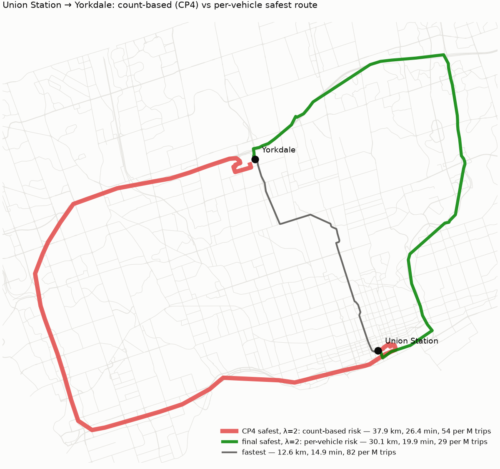
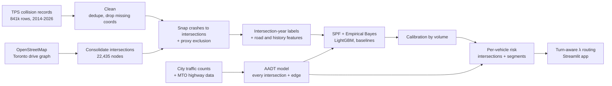
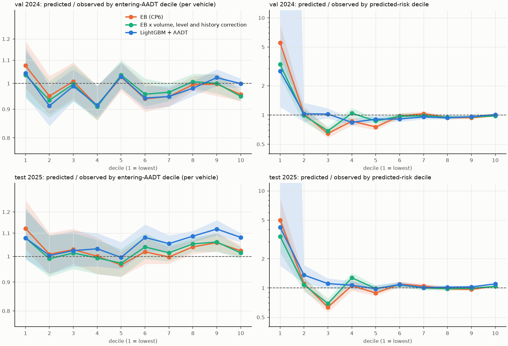
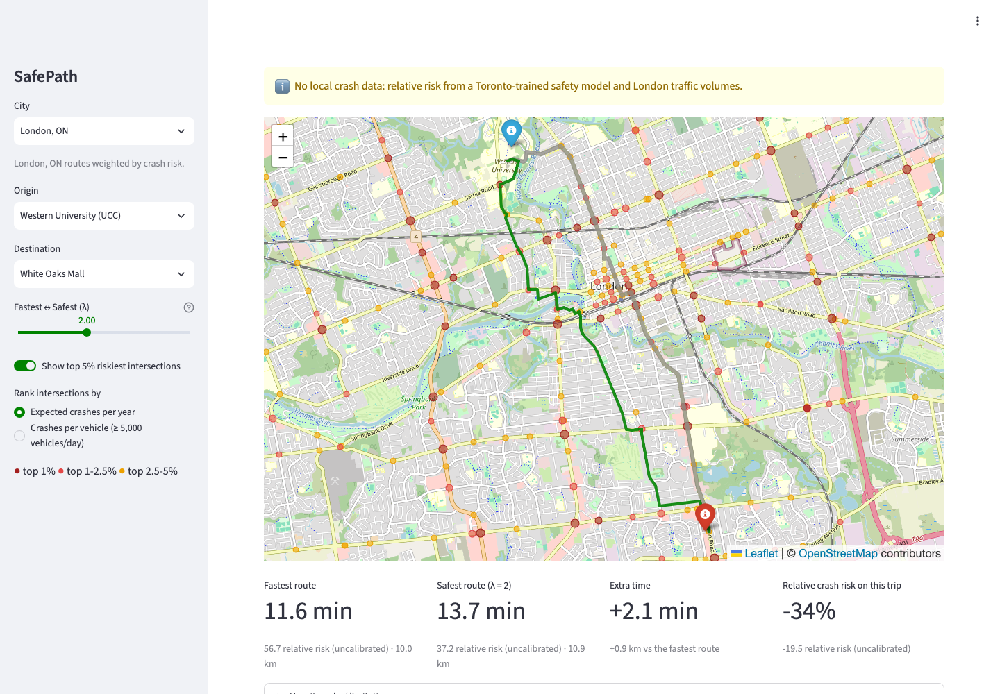
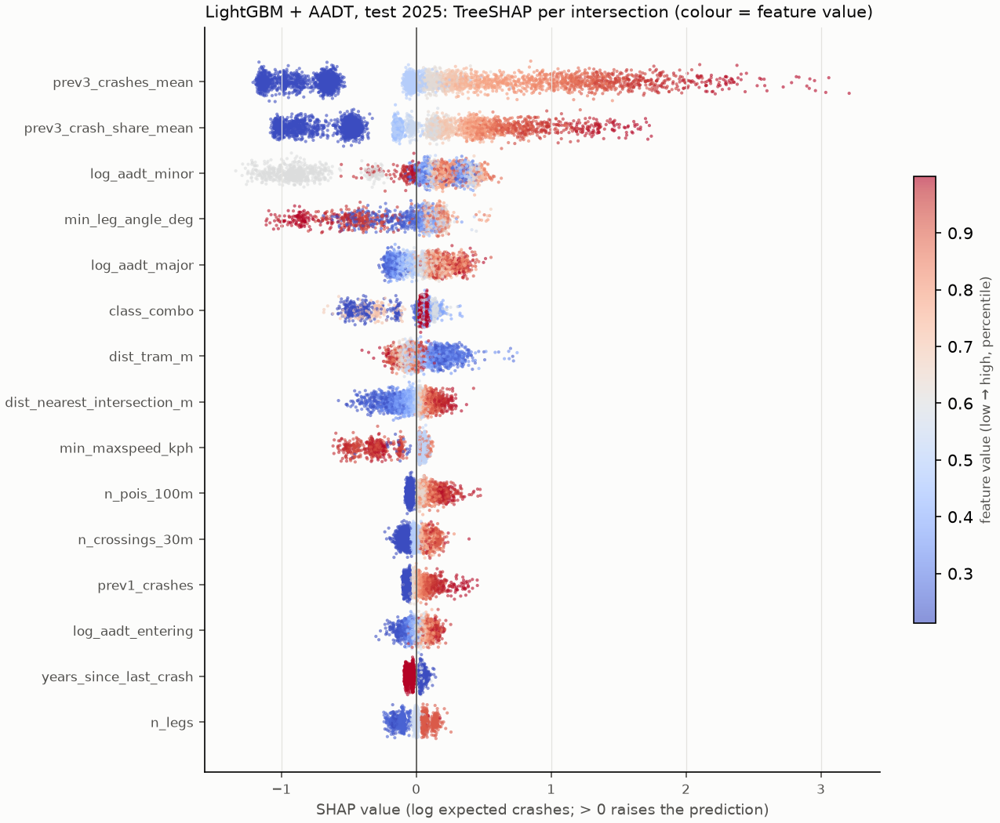
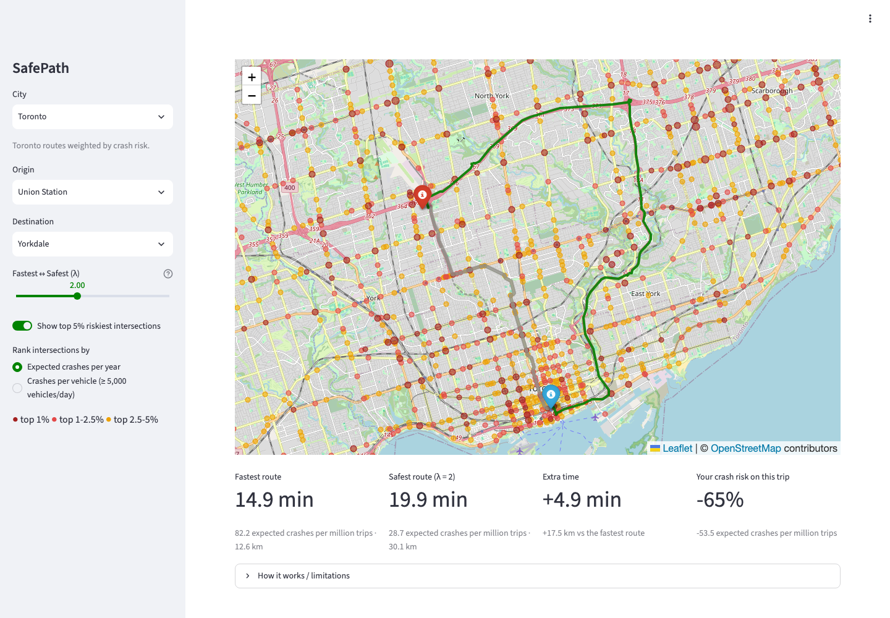

# SafePath

**Crash-risk-aware routing for Toronto, with a London, Ontario demo.** SafePath estimates the chance that *you* crash at
every intersection and on every road segment, from police-reported collisions and traffic
volumes, and routes with `cost = travel_time + λ · risk`. One slider moves between the fastest
route and the safest one, and the app shows exactly what the safer route costs in minutes.

**Live demo:** _URL to be added after deployment_ (Streamlit Community Cloud).

## Results at a glance

- **Exposure-aware risk changes the answer.** Per kilometre, primary roads look 20× riskier
  than residential streets; per vehicle-kilometre the gap is 1.2×. Routing on crash counts
  put 21% of safer-route kilometres on residential streets; routing per vehicle puts 8%.
- **Safer routes are cheap.** Over 200 random trips at λ = 1: median **+1.4 minutes** for
  **26% lower** expected crash risk; at λ = 2, +2.0 minutes for 29%.
- **A validated crash model.** Empirical Bayes on a negative binomial Safety Performance
  Function, recalibrated by traffic volume (per-vehicle calibration error 0.031 on the 2025
  test year), with leakage tests and spatial holdouts throughout.
- **Highways handled properly.** The OPP patrols the 400-series, so Toronto Police data holds
  only ~8% of their crashes. SafePath uses the Ministry of Transportation's own rates, and
  moves Gardiner/DVP crashes that police place at surface streets back onto the expressway,
  which lands both in the MTO freeway range.
- **Tested in a second city.** On Ottawa, with no Ottawa crash labels in training, Toronto
  models fed Ottawa's crash history find as many next-year crashes in their top 5% as an
  Ottawa-trained model (recall@5% 0.69, paired CIs within ±0.008), and with no Ottawa data at
  all the SPF doubles a road-class lookup (0.62 vs 0.29). On Spearman, Ottawa's own three-year
  crash average still beats every Toronto model.



*Union Station → Yorkdale at λ = 2. Count-based routing (red) took a 38 km Gardiner–427–401
loop and ended in a cul-de-sac behind the mall. Per-vehicle routing (green) takes the DVP and
the 401: 30 km, +5 minutes over the fastest route, 65% lower expected crash risk.*

## Problem and approach

A crash map shows where crashes happen, not where driving is dangerous: busy roads have more
crashes because they carry more cars. Routing on raw crash counts therefore avoids busy roads
and pushes drivers onto quiet residential streets and long freeway detours.

SafePath routes on the driver's own expected crashes per trip instead:

| | count-based (first version) | per-vehicle (current) |
|---|---|---|
| intersection | predicted crashes per year | Empirical Bayes crashes per year ÷ entering vehicles |
| road segment | crashes per km | crashes per vehicle-km |
| 400-series highways | proxy estimate from police data | MTO collision rate per vehicle-km |
| route total | crashes per year at the places passed | expected crashes per million trips |



## Data

| source | what | notes |
|---|---|---|
| Toronto Police Service, *Traffic Collisions* | 841,092 police-reported collisions, 2014-2026 | 16.3% have no location; TPS places crashes at intersections |
| City of Toronto, *Traffic Volumes* | 30,961 turning-movement and 45,043 tube counts, 1984-2026 | expanded to annual daily traffic with factors from the City's own 24-hour counts |
| Ontario MTO, Technical Publications | 400-series volumes (1988-2024) and collision rates (1988-2021) | the province's reportable-collision rates per vehicle-km |
| OpenStreetMap | drive graph, signals, crossings, streetcar tracks, POIs | current snapshot |

- **Intersections are the unit.** 704k located crashes sit on only 18,651 distinct points and
  96.3% are within 30 m of a consolidated intersection, so the crash model works per
  intersection and segments get class-level rates.
- **The OPP highway gap.** Toronto Police records about 8% of the collisions MTO counts on the
  401, so highway risk comes from MTO.
- **Proxy locations.** Mall parking-lot crashes and expressway crashes geocoded to nearby
  intersections are flagged by explicit rules computed on training years only and kept out
  of training ([`reports/labels.md`](reports/labels.md)).

## Models

### Traffic volume for every intersection and road

LightGBM on log AADT with road attributes and sampled betweenness on the travel-time graph,
scored on 2 km spatial blocks it never saw:

| unit | class-median baseline R² | model R² | median error, baseline → model |
|---|---:|---:|---:|
| intersections (entering vehicles) | 0.72 | **0.85** | 33% → 21% |
| segments (two-way vehicles) | 0.78 | **0.85** | 43% → 34% |

Counted locations blend their latest count with the model, weighted by how stale the count
is (estimated from 22,000 pairs of repeat counts). Details:
[`reports/volume_model.md`](reports/volume_model.md).

### Crashes per intersection (test year 2025, 22,404 intersections)

| model | Spearman [95% CI] | recall@5% [95% CI] | Poisson dev. | predicted / observed |
|---|---|---|---:|---:|
| persistence (own average) | 0.741 [0.734, 0.748] | 0.544 [0.529, 0.558] | 1.193 | 1.06 |
| LightGBM (road + history) | 0.740 [0.734, 0.747] | 0.554 [0.540, 0.569] | 1.027 | 1.08 |
| LightGBM + traffic volume | **0.744** [0.737, 0.750] | 0.554 [0.540, 0.569] | **1.011** | 1.08 |
| Safety Performance Function | 0.595 [0.585, 0.604] | 0.477 [0.459, 0.496] | 2.679 | 1.03 |
| **Empirical Bayes** (routing) | 0.733 [0.726, 0.739] | 0.552 [0.538, 0.566] | 1.058 | **1.03** |
| LightGBM, road features only, unseen 2 km blocks | 0.628 [0.619, 0.636] | 0.478 [0.459, 0.495] | 2.531 | 1.00 |

Recall@5% is the share of 2025 crashes at the 5% of intersections ranked riskiest; CIs from
1,000 bootstrap resamples of intersections. The road-features-only model, scored on spatial
blocks it never saw, beats a road-class lookup (Spearman 0.396) by a wide margin within
Toronto. In another city it does not: on Ottawa it falls below Ottawa's own class means
(see the cross-city test below).

- The **Safety Performance Function** is a negative binomial on major- and minor-road volume,
  signal, legs, leg angle, streetcar tracks and road classes, fitted separately for
  signalised 4-leg, signalised 3-leg and unsignalised intersections. Every volume elasticity
  falls in the literature's 0.3-0.9 range ([`reports/spf.md`](reports/spf.md)).
- **Empirical Bayes** blends it with each intersection's previous five years. LightGBM +
  volume ranks slightly better (paired Spearman difference 0.011); EB is better calibrated
  in total and keeps an interpretable model behind every number, which the app uses to
  explain each intersection ([`reports/model_comparison.md`](reports/model_comparison.md)).

### Calibration by traffic volume

Routing divides expected crashes by traffic, so calibration has to hold *per vehicle* across
volumes. A Poisson correction on volume, predicted level and crash history (fitted on
training years, chosen on 2024, confirmed on 2025) moves the quietest volume decile from 1.12
to 1.08 predicted/observed on test and the lowest predicted-risk decile from 5.0× to 3.4×
overpredicted. Observed crashes per million entering vehicles are nearly flat across volume
(0.5-0.8): quiet intersections are not safer per vehicle
([`reports/calibration.md`](reports/calibration.md)).



### Graph neural network

The road network as a graph: 22,435 intersections as nodes, 33,168 road links between them
as edges (class, length, lanes, speed limit, traffic volume). Each node carries the same 50
features as LightGBM + AADT. GraphSAGE and GATv2 are compared with an MLP on the same
features (no graph) and with LightGBM given hand-built 1- and 2-hop neighbour features, on the
same splits; GNN numbers average 5 seeds.

| test 2025 (Spearman [95% CI]) | all intersections | no crashes in prior 3 years | road features only, unseen 2 km blocks |
|---|---|---:|---|
| LightGBM + AADT | 0.744 [0.737, 0.751] | 0.304 | 0.628 [0.619, 0.637] (road-only LightGBM) |
| LightGBM + AADT + neighbour features | **0.746** [0.739, 0.752] | **0.312** | |
| MLP (no graph) | 0.739 [0.732, 0.746] | 0.283 | 0.621 [0.612, 0.630] |
| GraphSAGE | 0.743 [0.735, 0.749] | 0.297 | **0.629** [0.620, 0.639] |
| GraphSAGE + LightGBM ensemble | 0.745 [0.739, 0.752] | 0.304 | |

**Does the graph help?** Message passing beats the same network without it (GraphSAGE vs
MLP: +0.003 Spearman with crash history, +0.008 on unseen blocks with road features only,
both CIs above zero), but it does not beat gradient-boosted trees: GraphSAGE ties LightGBM +
AADT, trails LightGBM with neighbour features, and the ensemble adds +0.001. Most of the
signal is the intersection's own crash history, which every model already has. The GNNs also
overpredict the 2025 level by about 10% and are worse calibrated per vehicle on test, so
routing stays on recalibrated EB. Training runs on Apple-silicon GPU (MPS) at 0.34 s per epoch
for GraphSAGE versus 0.73 s on CPU; the code picks CUDA, MPS or CPU automatically. Details:
[`reports/gnn.md`](reports/gnn.md).

### Cross-city test: Ottawa

Toronto-trained models scored on 15,276 Ottawa intersections inside the City's urban
boundary (643 km²), test year 2024, with no Ottawa crash labels in any Toronto model's
training. Freeway crashes (Hwy 416/417, OPP roads absent from Toronto's data) are removed.
Ottawa traffic counts provide exposure; Toronto's volume model alone transfers badly (R² 0.57
on Ottawa counts vs 0.85 at home), so Ottawa AADT comes from an Ottawa-trained volume model.

| test 2024 | Ottawa data used | Spearman [95% CI] | recall@5% [95% CI] | PR-AUC |
|---|---|---|---|---:|
| Road features only: LightGBM / MLP / GraphSAGE | OSM (+ counts for GraphSAGE edges) | 0.318 / 0.366 / 0.352 | 0.586 / 0.517 / 0.556 | 0.566 / 0.519 / 0.558 |
| SPF, count-free (Toronto volume models) | OSM only | 0.363 [0.347, 0.379] | 0.619 [0.589, 0.646] | 0.576 |
| LightGBM + AADT (Ottawa history as features) | + counts, crash history | 0.425 [0.410, 0.440] | 0.689 [0.666, 0.707] | 0.677 |
| **EB** (Toronto SPF + Ottawa history) | + counts, crash history | 0.449 [0.435, 0.464] | **0.691** [0.668, 0.710] | 0.683 |
| Ottawa class-combo mean | Ottawa labels | 0.398 [0.383, 0.411] | 0.288 [0.259, 0.316] | 0.387 |
| Ottawa prev-3-year mean | Ottawa history | **0.526** [0.509, 0.543] | 0.684 [0.659, 0.702] | 0.601 |
| LightGBM + AADT trained on Ottawa (upper bound) | Ottawa labels | 0.488 [0.475, 0.501] | 0.690 [0.667, 0.709] | **0.710** |

83% of Ottawa intersection-years have no crash, so Spearman is dominated by ties; hotspot
recall@5% and PR-AUC are co-primary. Paired bootstrap CIs on test 2024:

- **Hotspots:** every Toronto model fed Ottawa's history matches the Ottawa-trained upper
  bound on recall@5% (differences −0.002 to +0.001, all CIs within ±0.008). On PR-AUC they
  trail it by 0.026-0.051 (CIs below zero).
- **No Ottawa data at all:** the count-free SPF roughly doubles the road-class baseline's
  recall@5% (+0.331 [+0.295, +0.369]) and PR-AUC (+0.189 [+0.172, +0.206]), though it is
  below the class means on Spearman (−0.035 [−0.052, −0.018]).
- **Ranking everything:** on Spearman nothing beats Ottawa's own three-year average (EB
  −0.077 [−0.087, −0.066]; Ottawa-trained −0.038 [−0.050, −0.027]).
- **Why the numbers are lower than Toronto's: sparsity.** Ottawa has 0.57 crashes per
  intersection-year against Toronto's 2.35, partly because Ottawa records keep mid-block
  crashes mid-block while Toronto Police place almost all at intersections (1.4 vs ~38
  crashes per distinct location). Thinning Toronto's own 2025 crashes to Ottawa's rate drops
  Toronto's best model from 0.744 to 0.584 Spearman.
- **Does the graph help?** Not clearly: road-only GraphSAGE beats road-only LightGBM on
  Spearman (+0.034) but loses on recall@5% (−0.030), and trails the graph-free MLP on
  Spearman (−0.014) while beating it on recall@5% (+0.039).

Ottawa 2023 collisions are unpublished, and 2024 shows a recording change (non-reportable
records appear, minor-injury crashes halve), so severity is not compared. Details, location
precision, volume transfer, feature shift and paired CIs:
[`reports/ottawa.md`](reports/ottawa.md).

### London, Ontario demo (no local crash data)

London publishes no collision records, so the London map uses the setting that transferred
best to Ottawa without local crash data: Toronto's Safety Performance Function on London's
OpenStreetMap roads and the City of London's traffic-volume layer (1,973 segments, AADT
rounded to 500; 90% matched to OSM, covering 95% of secondary and 83% of tertiary road km;
local streets without a count use a class median). The 401 and 402 use MTO rates. The app
labels London's numbers as **relative risk**: they keep Toronto's reporting level and are
not calibrated for London.

Sanity check against London Police's published top-10 collision intersections for
2014-2016 (from news coverage; 12 distinct intersections, not a rigorous label set): all
12 are in the model's top 1% of London's 5,637 intersections, but all 12 are also in the
top 1% by traffic volume alone, and the model ranks only 6 of them higher than volume does.
So the check shows the model is not wrong about London's known hotspots; it cannot show it
adds anything beyond traffic. Routing (200 random trips, k recalibrated for London): at
λ = 1, median +0.7 min for 17% lower relative risk; at λ = 2, +1.1 min for 21%. Details:
[`reports/london.md`](reports/london.md).



## Validation highlights

- **No leakage.** History features and EB use only years before the label year; tests
  perturb future years and check that nothing changes.
- **Temporal and spatial holdouts.** Train 2016-2019 + 2022-2023, validate 2024, test 2025;
  the volume model and the road-only crash model are scored on unseen 2 km blocks.
- **Honest baselines.** Persistence is hard to beat on ranking, and the tables say so.
- **Independent check on the attribution.** After moving surface-street crashes back onto
  the expressways, the Gardiner (1.03) and the DVP (0.61 collisions per million vehicle-km)
  land inside MTO's 0.5-1.1 freeway range, which the method was not tuned to hit.

## Routing results (200 random trips, 3-25 km)

| λ | version | median extra min | median detour | motorway share | residential share | risk reduction |
|---:|---|---:|---:|---:|---:|---:|
| 1 | count-based (first version) | 4.9 | 1.20× | 59% | 21% | n/a* |
| 1 | **per-vehicle, calibrated** | **1.4** | **1.04×** | 58% | **8%** | **26%** |
| 2 | count-based (first version) | 6.4 | 1.26× | 58% | 23% | n/a* |
| 2 | **per-vehicle, calibrated** | **2.0** | **1.07×** | 61% | **8%** | **29%** |

\*The count-based version measured crashes at the places passed, not the driver's risk.
Fastest routes: 50% motorway, 3% residential. Per kilometre driven, the 400-series are about
7× safer than primary arterials (0.9 vs 6.3 expected crashes per million vehicle-km), so safer
routes still lean on freeways.

**Is that lean an artefact of mixing MTO and police data?** Freeway rates halved or doubled,
or Gardiner/DVP/Allen volumes moved ±30%:

| variant (λ = 1) | motorway share | median extra min | risk reduction |
|---|---:|---:|---:|
| baseline | 58% | 1.4 | 26% |
| freeway rates ×0.5 | 62% | 1.4 | 30% |
| freeway rates ×2 | 54% | 1.6 | 23% |
| Gardiner/DVP/Allen volume +30% | 59% | 1.4 | 27% |
| Gardiner/DVP/Allen volume −30% | 57% | 1.4 | 25% |

The direction holds in every variant; the size of the freeway lean depends on the assumption.
Routing is turn-aware, with a U-turn penalty, and snaps destinations like a navigation app.
Details: [`reports/routing.md`](reports/routing.md).

## Explainability



TreeSHAP on LightGBM + traffic volume: crash history carries half the signal and traffic
volume a fifth; nearness to streetcar tracks, nearby activity and more legs push risk up as
expected. Three effects look backwards and trace to data quirks: very sharp leg angles and
100 km/h approaches are ramp and freeway merges with few recorded crashes, and single-road
clusters have no minor road at all.

In the app every intersection lists its top three factors from the routing model. For
example, **Ellesmere Rd / Kennedy Rd**: signalised 4+ leg intersection (×18.7 the citywide
average), about three times more crashes than its design and volume predict (×3.2), and high
traffic volume (×2.9). Details: [`reports/shap.md`](reports/shap.md).



## Experiment tracking

Volume-model CV, the LightGBM models, SPF/EB, the model comparison, calibration and the
routing evaluation are logged to Weights & Biases with config, metrics, plots and the git
commit: **[wandb: safepath](https://forge.coreweave.com/wandb/kimmer-university-of-waterloo/safepath)**. Tracking is optional: it turns on when `WANDB_API_KEY` is set
(environment or a local `.env`), and `--no-wandb` turns it off.

## Quickstart

Requires Python 3.11+. Stack: pandas, GeoPandas, OSMnx, NetworkX, LightGBM, statsmodels,
scikit-learn, PyTorch and PyTorch Geometric (optional), Streamlit.

```bash
python -m venv .venv && source .venv/bin/activate
pip install -e ".[dev]"            # add ",tracking" for W&B, ",gnn" for PyTorch + PyG

python -m safepath all             # download, build, model, score, route (~15 min, mostly downloads)
python -m safepath app             # open the Streamlit app
python -m safepath gnn             # optional: GNN grid, 5 seeds, spatial folds (~45 min on a laptop GPU)
python -m safepath ottawa          # cross-city test (needs `all` and `gnn` first; configs/ottawa.yaml)
python -m safepath london          # London demo (needs `all`; configs/london.yaml)
python -m safepath bundle          # slim app data for both cities -> app_bundle/
```

The deployed app needs none of the pipeline: it reads only `app_bundle/` (9.7 MB, committed)
and installs `deploy/requirements.txt` (Streamlit, folium, numpy, pandas, pyarrow, scipy;
the same pins as `requirements-app.txt`). To run it the way Streamlit Community Cloud does:

```bash
python -m venv .venv-app && .venv-app/bin/pip install -r deploy/requirements.txt
.venv-app/bin/streamlit run deploy/streamlit_app.py
```

Steps also run on their own: `download`, `clean`, `report-data`, `graph`, `locations`,
`snap`, `report-snap`, `features`, `volumes`, `mto`, `volume-model`, `train`, `spf`, `eb`,
`evaluate`, `calibration`, `score`, `explain`, `exposure`, `route`, `app`, and for Ottawa
`ottawa-data`, `ottawa-build`, `ottawa-volumes`, `ottawa-transfer`. If the main Overpass
server rate-limits you, `SAFEPATH_OVERPASS_URL` points OSMnx at a mirror. Network fetches
retry and then fail loudly; `all` stops at the first failing step. Configuration lives in
`configs/default.yaml`; `pytest` runs the test suite. The app takes shareable query
parameters, e.g. `?city=london&origin=Masonville+Place&destination=White+Oaks+Mall&lam=2`.

## Limitations

- **Police-reported data with non-random gaps:** 16.3% of collisions have no location, more
  often property-damage-only ones (16.8%) than fatal ones (4.3%).
- **Intersection-snapped locations:** TPS places crashes at intersections, so mid-block risk
  is coarse.
- **Current OSM snapshot:** road features describe today's network, not each past year's.
- **MTO/TPS comparability:** highway rates (MTO) and city rates (police) are treated as
  comparable; the sensitivity analysis bounds the effect but does not remove the assumption.
- **Modelled volumes:** most local streets have no count, so their volumes come from the
  model (typical error 20-45%); the city expressways use a lane-based estimate.
- **Minor > major elasticity:** in every SPF group the minor-road volume effect exceeds the
  major-road one, which is unusual and probably reflects noise in modelled volumes.
- **Attribution may overreach:** a few large reassignments to the Gardiner (Park Lawn,
  British Columbia Rd) may include genuine surface-street crashes.
- **Neighbourhood externality:** routing minimises the driver's own risk and can still send
  traffic through local streets, moving risk onto people who live and walk there.
- **Changing jurisdiction:** the province has announced it will take over the Gardiner and
  DVP; if their crashes move to OPP records, the attribution will need MTO data instead.
- **Free-flow travel times:** congestion would make long freeway detours less attractive.
- **Cross-city limits:** Ottawa geocodes crashes differently from Toronto Police, its 2023
  data is unpublished, and its 2024 records change how minor-injury and non-reportable
  collisions are coded; Ottawa's segment volumes come from Toronto's model with a level
  correction chosen on Ottawa's intersection counts.
- **London is relative only:** no London crash data; risk is a Toronto model's expectation,
  the volume layer has no count dates, and most local streets use a class-median volume.

## Roadmap

- **Phase 3: generalisation.** Done: a graph neural network against LightGBM and the SPF;
  a cross-city test on Ottawa; a London, Ontario demo without local crash data.
- **Phase 4: product.** Next: the public deployment (the app is ready for Streamlit
  Community Cloud) and a model card; later, time- and weather-aware risk.

## Repository layout

```
configs/default.yaml        pipeline configuration (paths, thresholds, splits, proxy rules)
configs/ottawa.yaml         Ottawa overrides (study area, years, services)
configs/london.yaml         London overrides (municipal boundary, volume layer)
app_bundle/                 precomputed app data per city (routing arrays, intersections)
deploy/                     Streamlit Community Cloud entrypoint and requirements
src/safepath/data/          collisions, City traffic counts (AADT), MTO highway data
src/safepath/features/      labels, proxy rules, road, history and volume features
src/safepath/models/        baselines, LightGBM, volume model, SPF, EB, calibration
src/safepath/graph.py       OSM graph, consolidated intersections, segment view
src/safepath/snapping.py    crash-to-intersection / segment assignment
src/safepath/risk.py        per-vehicle risk onto the routing graph
src/safepath/movements.py   turn-aware routing graph (U-turn penalty)
src/safepath/routing.py     λ routing, k calibration, evaluation, sensitivity
src/safepath/explain.py     SHAP and per-intersection risk factors
src/safepath/gnn/           intersection graph, MLP / GraphSAGE / GATv2, training, transfer
src/safepath/ottawa/        Ottawa build, volume and crash-model transfer, report
src/safepath/london/        London volumes, risk, routing evaluation, report
src/safepath/router.py      turn-aware routing on compact arrays (used by the app)
src/safepath/bundle.py      writes app_bundle/
src/safepath/tracking.py    optional Weights & Biases logging
src/safepath/app/           Streamlit app
reports/                    generated reports and figures
tests/                      unit tests (leakage, calibration, routing, snapping, ...)
```

## Data attribution

- Collision data: Toronto Police Service, Public Safety Data Portal, *Traffic Collisions*,
  [Open Government Licence – Toronto](https://open.toronto.ca/open-data-license/).
- Traffic counts: City of Toronto, *Traffic Volumes* (turning movement and speed / volume /
  classification counts), Open Government Licence – Toronto.
- Ottawa collisions, intersection traffic counts and urban boundary: City of Ottawa open
  data (open.ottawa.ca), Open Government Licence – City of Ottawa.
- London traffic volumes: City of London open data (*Traffic Volumes*), used and
  redistributed in derived form (app_bundle/) under the
  [Terms of Use – City of London Open Data](https://london.maps.arcgis.com/sharing/rest/content/items/e31458fd0c7e41dd9f93144a9550781d/data).
- Provincial highway volumes and collision rates: Ontario Ministry of Transportation,
  Technical Publications, [Open Government Licence – Ontario](https://www.ontario.ca/page/open-government-licence-ontario).
- Road network, points of interest and basemap tiles: © [OpenStreetMap](https://www.openstreetmap.org/copyright)
  contributors, available under the Open Database License (ODbL).

## License

MIT, see [LICENSE](LICENSE).
