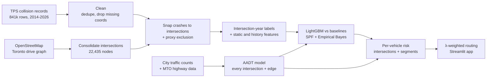

# SafePath

**Crash-risk-aware routing for Toronto.** SafePath estimates each driver's own crash risk on
every intersection and road segment (expected crashes per vehicle, from police-reported
collisions and traffic volumes) and routes with `cost = travel_time + λ · risk`. A single
slider moves between the fastest route and the safest one, and the app shows exactly what
the safer route costs in minutes.


The goal is a rigorous, honest ML pipeline rather than a flashy number: temporal holdouts,
strong baselines, bootstrap confidence intervals, a unit-tested guarantee against label
leakage, and a written account of where the model and the data fall short. No LLMs are used
anywhere in the system.

## How it works



1. **Collisions.** 841,092 Toronto Police Service records are downloaded from the open-data
   FeatureServer (paginated, cached, verified against the service's own count), cleaned, and
   deduplicated. 136,730 records (16.3%) have no location and are dropped.
2. **Road network.** The OSM drive graph is projected to UTM 17N and its intersections are
   consolidated (nodes within 20 m merge), so a divided-road junction drawn as four OSM nodes
   becomes one intersection.
3. **Snapping.** Each crash point is assigned to an intersection (≤ 30 m), a mid-block
   segment (≤ 20 m from an edge), or excluded (inside a parking lot or off-network).
4. **Labels and features.** One row per intersection per year: crash count, severe count, and
   features from OSM (approach-road classes, legs, skew, speed limits, lanes, signals, stop
   signs, crossings, streetcar tracks, bus stops, nearby activity, distance to motorways and
   malls) plus crash history drawn only from earlier years.
5. **Model.** LightGBM with a Poisson objective, early-stopped on 2024 and tested on 2025,
   compared against three baselines.
6. **Traffic volumes.** City of Toronto turning-movement and tube counts are expanded to
   annual daily traffic, MTO supplies the 400-series, and a LightGBM model with sampled
   betweenness fills in every uncounted intersection and road (`reports/volumes.md`,
   `reports/volume_model.md`).
7. **Risk and routing.** A negative binomial Safety Performance Function on traffic volume
   and road features, blended with each intersection's own crash history by Empirical Bayes,
   gives expected 2026 crashes; divided by the vehicles entering, that is the risk for one
   driver. Road segments carry a crash rate per vehicle-km (MTO's rates on the 400-series).
   A directed edge carries the risk of the intersection it enters (charged once per
   intersection) plus its segment risk. Turn-aware Dijkstra on `travel_time + λ · k · risk`
   gives the route for any λ.

## Quickstart

Requires Python 3.11+.

```bash
python -m venv .venv && source .venv/bin/activate
pip install -e ".[dev]"

python -m safepath all     # download, build the graph, train, evaluate, score (10-15 min, mostly OSM downloads)
python -m safepath app     # open the Streamlit app
```

Individual steps can be run on their own: `download`, `clean`, `report-data`, `graph`,
`locations`, `snap`, `report-snap`, `features`, `volumes`, `mto`, `volume-model`, `train`,
`spf`, `eb`, `evaluate`, `score`, `exposure`, `route`, `app`.
Network fetches retry with backoff and then fail with a non-zero exit; `all` stops at the
first failing step. Configuration lives in `configs/default.yaml`; `pytest` runs the test
suite.

The app accepts query parameters for shareable views, e.g.
`?origin=Union+Station&destination=Yorkdale&lam=2`.

## Data and design decisions

**Intersections are the unit of analysis.** TPS places collisions on a small set of points:
704,362 located crashes sit on only 18,651 distinct coordinates. Against the consolidated OSM
graph, 96.3% of crashes fall within 30 m of an intersection (median 2 m), and only 3.5% sit
mid-block, a large share of them beside expressways. Modelling segments would mean training
on approximate locations, so the model works at intersection level and segments get simple
class-level rates. Details: [`reports/location_analysis.md`](reports/location_analysis.md).

**Consolidation tolerance.** OSMnx tolerances of 10, 15 and 20 m were compared. 10 m (nodes
within 20 m merge) keeps 91.6% of crashes within 10 m of their intersection; larger
tolerances pull cluster centres away from where TPS places crashes and start merging
genuinely separate intersections.

**Proxy exclusions.** Some intersections inherit crashes that happened elsewhere, and both
patterns were flagged with explicit rules computed from training years only:

- *Retail proxies (23):* parking-lot crashes geocoded to the nearest public intersection.
  These have ≥ 150 train crashes, ≤ 8% severe, ≥ 25% hit-and-run, and lie within 150 m of a
  mall or large retail area. Examples: Highland Hill by Yorkdale, Borough / Progress at
  Scarborough Town Centre, Fairview, Sherway.
- *Expressway proxies (8):* expressway crashes placed at a nearby surface intersection.
  These lie within 200 m of a motorway and have ≥ 20× the median crashes for their road-class
  combination. Examples: residential corners beside the DVP with 1,000+ crashes.

Flagged intersections are excluded from training and headline evaluation, and at
scoring time they get the SPF estimate instead of their inflated counts. The full
list with reasons is in
[`reports/excluded_intersections.csv`](reports/excluded_intersections.csv).

**Highways.** The 401, 400, 404, 409, 427 and QEW are patrolled by the OPP, so Toronto Police
data barely contains their crashes; they use the Ministry of Transportation's own collision
rates per million vehicle-km (0.5-1.0 in Toronto, [`reports/mto.md`](reports/mto.md)). Toronto
Police places many Gardiner and DVP crashes at surface intersections beside or under them;
crashes there above the SPF expectation are moved back to the expressway, which brings both
into the MTO range. Other road classes get rates per vehicle-km from mid-block crashes.
Details: [`reports/risk.md`](reports/risk.md).

**Temporal splits.** Train label years 2016–2019 and 2022–2023, validation 2024, test 2025.
2020–2021 are used only as history (with a COVID-window indicator, and history features
also expressed as a share of the citywide total to absorb the level shift). 2026 is a
partial year and is never a label.

## Results

### Risk model (test year 2025, 22,404 intersections)

| model | Spearman [95% CI] | PR-AUC | ROC-AUC | recall@5% [95% CI] | Poisson dev. |
|---|---|---:|---:|---|---:|
| Prior 3-year mean | 0.735 [0.727, 0.743] | 0.839 | 0.872 | 0.553 [0.538, 0.567] | 1.125 |
| Persistence (train-period mean per intersection) | 0.741 [0.734, 0.748] | 0.858 | 0.889 | 0.544 [0.528, 0.558] | 1.193 |
| Road-class mean (no history) | 0.396 [0.384, 0.408] | 0.555 | 0.669 | 0.232 [0.219, 0.247] | 5.315 |
| **LightGBM (static + history)** | 0.740 [0.734, 0.747] | **0.879** | **0.898** | 0.554 [0.539, 0.568] | **1.027** |
| LightGBM static only, unseen 2 km blocks | 0.628 [0.619, 0.636] | 0.794 | 0.829 | 0.478 [0.459, 0.495] | 2.531 |

Recall@5% is the share of next-year crashes that occur at the 5% of intersections the model
ranks highest. CIs come from 1,000 bootstrap resamples of intersections.

What this says, plainly:

- **On ranking, LightGBM ties a strong persistence baseline.** The paired Spearman
  difference is −0.000 [−0.004, +0.003]. It does capture slightly more crashes in its top 5%
  (+1.0 point, CI [+0.6, +1.5]), and it is better calibrated (lower Poisson deviance, higher
  PR-AUC) because it predicts small non-zero risk where persistence predicts exactly zero.
  Recent crash history carries over 90% of the model's gain.
- **Road features alone transfer.** Scored on spatial blocks it never saw, the static-only
  model reaches Spearman 0.628, against 0.396 for a road-class lookup. That is the relevant
  number for intersections with no crash record and for other cities. When the same model is
  scored on intersections it trained on, it reaches 0.728, because continuous features act as
  an intersection fingerprint; that number overstates transfer and is not used.
- Full tables, the severe-crash model, and validation-year results:
  [`reports/metrics.md`](reports/metrics.md).


### Routing trade-off (200 random trips, 3–25 km)

`k` = 31.1 seconds per (expected crash per million trips), chosen so that at λ = 1 the median
route's risk cost equals its median travel time.

| λ | median extra min | p90 extra min | median risk reduction | p90 risk reduction |
|---:|---:|---:|---:|---:|
| 0.5 | 0.6 | 2.3 | 21% | 46% |
| 1 | 1.5 | 3.6 | 27% | 50% |
| 2 | 2.0 | 5.1 | 29% | 53% |

"Risk" is the expected number of crashes for one driver making the trip. The numbers above
are for per-vehicle risk (Phase 2); the count-based Phase 1 version claimed larger
reductions but measured something else (crash-prone places passed), see
[`reports/routing.md`](reports/routing.md).


More sweeps: [`reports/routing.md`](reports/routing.md).

## Limitations

- **Modelled exposure.** Most roads have no traffic count; their volumes come from a model
  with a typical error of 20-45%, and the city expressways' volumes are a lane-based estimate.
- **Freeways are safer per vehicle-km, and routes use them.** With MTO's rates the 400-series
  are several times safer per km driven than arterials, so safer routes still lean on
  freeways (Union Station to Yorkdale at λ = 2 goes by the DVP and the 401: 30 km instead of
  13, +5 minutes). This rests on treating MTO and Toronto Police crash records as
  comparable; halving or doubling the freeway rates does not change the direction.
- **Own risk, not everyone's.** Per-vehicle routing can still send traffic through local
  streets when they are safer per vehicle, moving risk onto people who live and walk there.
- **Police-reported data with non-random gaps.** 16.3% of records have no location, and
  missing locations are more common for property-damage-only collisions (16.8%) than for
  fatal ones (4.3%).
- **Intersection-snapped locations.** TPS offsets crashes to intersections, so mid-block risk
  is only coarsely represented.
- **Current OSM snapshot.** Road features describe today's network, not the network in each
  label year.
- **Heuristic proxy rules.** The retail and expressway rules are documented and conservative,
  but they are heuristics; near-misses are listed in [`reports/labels.md`](reports/labels.md).

## Roadmap

- **Phase 2: exposure and calibration.** Done: Toronto traffic counts and MTO data for
  exposure, a Safety Performance Function blended with each intersection's history by
  Empirical Bayes, per-vehicle routing. Next: calibration checks, SHAP explanations,
  experiment tracking with Weights & Biases, and a rewrite of these Results.
- **Phase 3: generalisation.** A graph neural network on the road graph against LightGBM; a
  cross-city test on Ottawa collision data; a London, Ontario demo using the static-only / SPF
  model.
- **Phase 4: product.** A deployed demo, a model card, and time- and weather-aware risk.

## Repository layout

```
configs/default.yaml        pipeline configuration (paths, thresholds, splits, proxy rules)
src/safepath/data/          collisions, City traffic counts (AADT), MTO highway data
src/safepath/graph.py       OSM graph, consolidated intersections, segment view
src/safepath/snapping.py    crash-to-intersection / segment assignment
src/safepath/features/      labels, proxy rules, static and history features
src/safepath/models/        baselines, LightGBM, volume model, SPF, Empirical Bayes
src/safepath/evaluate.py    metrics, bootstrap CIs, figures
src/safepath/risk.py        per-vehicle risk onto the routing graph
src/safepath/routing.py     λ-weighted routing, k calibration, sensitivity, Pareto sweeps
src/safepath/movements.py   turn-aware routing graph (U-turn penalty)
src/safepath/app/           Streamlit app
reports/                    generated reports and figures
tests/                      unit tests (leakage, routing, snapping, metrics, ...)
```

## Data attribution

- Collision data: Toronto Police Service, Public Safety Data Portal, *Traffic Collisions*,
  used under the [Open Government Licence – Toronto](https://open.toronto.ca/open-data-license/).
- Traffic counts: City of Toronto, *Traffic Volumes* (turning movement and speed / volume /
  classification counts), Open Government Licence – Toronto.
- Provincial highway volumes and collision rates: Ontario Ministry of Transportation,
  Technical Publications, [Open Government Licence – Ontario](https://www.ontario.ca/page/open-government-licence-ontario).
- Road network, points of interest and basemap tiles: © [OpenStreetMap](https://www.openstreetmap.org/copyright)
  contributors, available under the Open Database License (ODbL).

## License

MIT, see [LICENSE](LICENSE).
