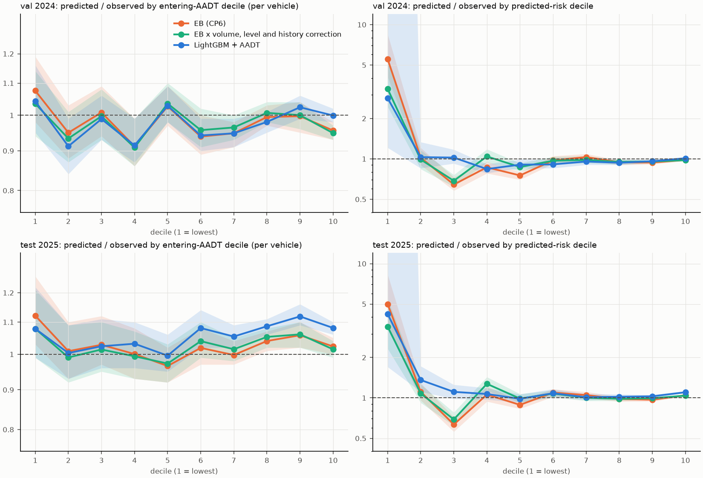

# Calibration by traffic volume (CP7)

Routing divides expected crashes by entering vehicles, so the check that matters is predicted / observed crashes within entering-AADT deciles: within a decile the vehicles cancel, so this is also the per-vehicle ratio. Clean intersections; CIs from 500 bootstrap resamples within each decile.

## Candidates

Recalibrations are Poisson GLMs with offset log(EB), fitted on train label years only, with train-year effects averaged out and the train level held fixed. Selection rule, fixed before looking at test: lowest per-vehicle calibration error (mean |log(pred/obs)| over validation AADT deciles), then total level, then deviance.

- `EB x volume correction`: `crash_count ~ cr(log_aadt, df=5) + C(year)`
- `EB x volume, level and history correction`: `crash_count ~ cr(log_aadt, df=5) + cr(log_eb, df=5) + zero_history + C(year)`

| split | model | per-vehicle CE (AADT deciles) | CE (predicted deciles) | quietest AADT decile ratio | lowest predicted decile ratio | total predicted / observed | Poisson deviance | Spearman |
|---|---|---:|---:|---:|---:|---:|---:|---:|
| val | EB (CP6) | 0.042 | 0.279 | 1.076 | 5.540 | 0.971 | 1.143 | 0.725 |
| val | EB x volume correction | 0.038 | 0.261 | 1.037 | 4.909 | 0.972 | 1.144 | 0.725 |
| val | EB x volume, level and history correction | 0.038 | 0.194 | 1.035 | 3.321 | 0.972 | 1.138 | 0.725 |
| val | LightGBM + AADT | 0.042 | 0.162 | 1.042 | 2.833 | 0.992 | 1.062 | 0.734 |
| val | 50/50 blend (recalibrated EB, LightGBM + AADT) | 0.039 | 0.394 | 1.039 | 21.239 | 0.982 | 1.055 | 0.737 |
| test | EB (CP6) | 0.033 | 0.258 | 1.121 | 5.002 | 1.029 | 1.058 | 0.733 |
| test | EB x volume correction | 0.031 | 0.250 | 1.081 | 4.944 | 1.029 | 1.058 | 0.733 |
| test | EB x volume, level and history correction | 0.031 | 0.206 | 1.079 | 3.393 | 1.029 | 1.054 | 0.733 |
| test | LightGBM + AADT | 0.054 | 0.217 | 1.079 | 4.213 | 1.081 | 1.011 | 0.744 |
| test | 50/50 blend (recalibrated EB, LightGBM + AADT) | 0.042 | 0.444 | 1.079 | 34.292 | 1.055 | 0.996 | 0.745 |

**Chosen for routing: EB x volume, level and history correction.** Best per-vehicle calibration on validation (0.038 vs 0.042 for EB and 0.042 for LightGBM + AADT); on test 0.031 vs 0.033 and 0.054, so test confirms it. Total level on test 1.029 vs 1.081 for LightGBM + AADT. LightGBM + AADT still ranks better (test Spearman 0.744 vs 0.733) and has lower deviance; the differences in per-vehicle calibration are small, and the EB route keeps an interpretable SPF behind every intersection's risk.

## Val 2024, by entering-AADT decile: EB (CP6), before

| decile | median entering AADT | observed crashes | predicted | predicted / observed | 95% CI | observed per MEV | predicted per MEV |
|---:|---:|---:|---:|---:|---|---:|---:|
| 1 | 887.405 | 537.000 | 577.553 | 1.076 | [0.97, 1.19] | 0.763 | 0.821 |
| 2 | 1,226.027 | 775.000 | 735.896 | 0.950 | [0.88, 1.03] | 0.771 | 0.732 |
| 3 | 1,554.577 | 903.000 | 910.656 | 1.008 | [0.93, 1.10] | 0.708 | 0.714 |
| 4 | 1,994.319 | 1,285.000 | 1,171.883 | 0.912 | [0.85, 0.98] | 0.785 | 0.715 |
| 5 | 2,737.207 | 1,410.000 | 1,447.892 | 1.027 | [0.97, 1.09] | 0.621 | 0.637 |
| 6 | 4,644.649 | 2,364.000 | 2,219.199 | 0.939 | [0.89, 0.99] | 0.597 | 0.561 |
| 7 | 10,409.705 | 4,816.000 | 4,565.404 | 0.948 | [0.91, 0.98] | 0.565 | 0.536 |
| 8 | 17,639.191 | 8,654.000 | 8,608.738 | 0.995 | [0.96, 1.02] | 0.597 | 0.594 |
| 9 | 26,277.245 | 10,637.000 | 10,608.651 | 0.997 | [0.95, 1.04] | 0.493 | 0.492 |
| 10 | 36,322.171 | 22,989.000 | 21,972.333 | 0.956 | [0.93, 0.98] | 0.730 | 0.698 |

## Val 2024, by entering-AADT decile: EB x volume, level and history correction, after

| decile | median entering AADT | observed crashes | predicted | predicted / observed | 95% CI | observed per MEV | predicted per MEV |
|---:|---:|---:|---:|---:|---|---:|---:|
| 1 | 887.405 | 537.000 | 555.746 | 1.035 | [0.94, 1.15] | 0.763 | 0.790 |
| 2 | 1,226.027 | 775.000 | 723.458 | 0.933 | [0.86, 1.01] | 0.771 | 0.720 |
| 3 | 1,554.577 | 903.000 | 900.467 | 0.997 | [0.92, 1.09] | 0.708 | 0.706 |
| 4 | 1,994.319 | 1,285.000 | 1,167.575 | 0.909 | [0.85, 0.97] | 0.785 | 0.713 |
| 5 | 2,737.207 | 1,410.000 | 1,459.719 | 1.035 | [0.98, 1.10] | 0.621 | 0.643 |
| 6 | 4,644.649 | 2,364.000 | 2,262.052 | 0.957 | [0.91, 1.01] | 0.597 | 0.571 |
| 7 | 10,409.705 | 4,816.000 | 4,644.838 | 0.964 | [0.93, 1.00] | 0.565 | 0.545 |
| 8 | 17,639.191 | 8,654.000 | 8,715.717 | 1.007 | [0.98, 1.03] | 0.597 | 0.601 |
| 9 | 26,277.245 | 10,637.000 | 10,639.948 | 1.000 | [0.95, 1.04] | 0.493 | 0.494 |
| 10 | 36,322.171 | 22,989.000 | 21,802.905 | 0.948 | [0.92, 0.97] | 0.730 | 0.693 |

## Val 2024, by predicted-risk decile (before / after)

| decile | EB pred/obs | EB 95% CI | chosen pred/obs | chosen 95% CI |
|---:|---:|---|---:|---|
| 1 | 5.540 | [3.95, 8.96] | 3.321 | [2.35, 5.11] |
| 2 | 1.021 | [0.90, 1.19] | 0.989 | [0.88, 1.17] |
| 3 | 0.644 | [0.58, 0.73] | 0.687 | [0.62, 0.77] |
| 4 | 0.865 | [0.78, 0.97] | 1.043 | [0.94, 1.15] |
| 5 | 0.753 | [0.70, 0.82] | 0.870 | [0.81, 0.93] |
| 6 | 0.975 | [0.92, 1.05] | 0.969 | [0.91, 1.04] |
| 7 | 1.031 | [0.98, 1.09] | 0.982 | [0.93, 1.04] |
| 8 | 0.944 | [0.91, 0.99] | 0.950 | [0.91, 0.99] |
| 9 | 0.939 | [0.91, 0.97] | 0.957 | [0.93, 0.99] |
| 10 | 0.983 | [0.96, 1.00] | 0.979 | [0.96, 1.00] |

## Test 2025, by entering-AADT decile: EB (CP6), before

| decile | median entering AADT | observed crashes | predicted | predicted / observed | 95% CI | observed per MEV | predicted per MEV |
|---:|---:|---:|---:|---:|---|---:|---:|
| 1 | 887.405 | 540.000 | 605.466 | 1.121 | [1.03, 1.26] | 0.767 | 0.861 |
| 2 | 1,226.027 | 768.000 | 775.036 | 1.009 | [0.94, 1.10] | 0.764 | 0.771 |
| 3 | 1,554.577 | 929.000 | 955.430 | 1.028 | [0.96, 1.10] | 0.729 | 0.749 |
| 4 | 1,994.319 | 1,236.000 | 1,236.826 | 1.001 | [0.93, 1.08] | 0.755 | 0.755 |
| 5 | 2,737.207 | 1,543.000 | 1,490.240 | 0.966 | [0.92, 1.02] | 0.679 | 0.656 |
| 6 | 4,644.649 | 2,252.000 | 2,294.894 | 1.019 | [0.97, 1.08] | 0.569 | 0.580 |
| 7 | 10,409.705 | 4,712.000 | 4,701.432 | 0.998 | [0.96, 1.04] | 0.553 | 0.552 |
| 8 | 17,639.191 | 8,436.000 | 8,773.583 | 1.040 | [1.01, 1.07] | 0.582 | 0.605 |
| 9 | 26,277.245 | 10,221.000 | 10,813.627 | 1.058 | [1.02, 1.09] | 0.474 | 0.502 |
| 10 | 36,322.171 | 22,082.000 | 22,599.788 | 1.023 | [1.00, 1.04] | 0.701 | 0.718 |

## Test 2025, by entering-AADT decile: EB x volume, level and history correction, after

| decile | median entering AADT | observed crashes | predicted | predicted / observed | 95% CI | observed per MEV | predicted per MEV |
|---:|---:|---:|---:|---:|---|---:|---:|
| 1 | 887.405 | 540.000 | 582.538 | 1.079 | [0.99, 1.21] | 0.767 | 0.828 |
| 2 | 1,226.027 | 768.000 | 760.809 | 0.991 | [0.92, 1.08] | 0.764 | 0.757 |
| 3 | 1,554.577 | 929.000 | 942.164 | 1.014 | [0.94, 1.09] | 0.729 | 0.739 |
| 4 | 1,994.319 | 1,236.000 | 1,228.589 | 0.994 | [0.92, 1.07] | 0.755 | 0.750 |
| 5 | 2,737.207 | 1,543.000 | 1,501.102 | 0.973 | [0.92, 1.03] | 0.679 | 0.661 |
| 6 | 4,644.649 | 2,252.000 | 2,341.167 | 1.040 | [0.99, 1.10] | 0.569 | 0.591 |
| 7 | 10,409.705 | 4,712.000 | 4,782.671 | 1.015 | [0.98, 1.05] | 0.553 | 0.561 |
| 8 | 17,639.191 | 8,436.000 | 8,881.666 | 1.053 | [1.02, 1.08] | 0.582 | 0.613 |
| 9 | 26,277.245 | 10,221.000 | 10,842.076 | 1.061 | [1.02, 1.09] | 0.474 | 0.503 |
| 10 | 36,322.171 | 22,082.000 | 22,406.421 | 1.015 | [0.99, 1.03] | 0.701 | 0.712 |

## Test 2025, by predicted-risk decile (before / after)

| decile | EB pred/obs | EB 95% CI | chosen pred/obs | chosen 95% CI |
|---:|---:|---|---:|---|
| 1 | 5.002 | [3.49, 8.59] | 3.393 | [2.36, 5.40] |
| 2 | 1.110 | [0.96, 1.33] | 1.078 | [0.94, 1.28] |
| 3 | 0.634 | [0.57, 0.72] | 0.691 | [0.61, 0.77] |
| 4 | 1.058 | [0.95, 1.18] | 1.273 | [1.13, 1.43] |
| 5 | 0.887 | [0.82, 0.95] | 0.988 | [0.92, 1.06] |
| 6 | 1.094 | [1.03, 1.17] | 1.076 | [1.01, 1.16] |
| 7 | 1.050 | [1.00, 1.11] | 1.003 | [0.95, 1.06] |
| 8 | 0.982 | [0.95, 1.02] | 0.984 | [0.95, 1.02] |
| 9 | 0.968 | [0.94, 0.99] | 0.993 | [0.96, 1.02] |
| 10 | 1.046 | [1.03, 1.06] | 1.040 | [1.02, 1.06] |

## What remains

The lowest predicted-risk decile is still overpredicted several-fold by every candidate. Those are intersections with no crash in the history window and almost none in the label year (a few dozen crashes across ~2,200 intersections), so the ratio is noisy and the absolute error is a few hundredths of a crash per year. Per vehicle, their predicted risk stays well below that of busier intersections, so the effect on routing is a small extra penalty on quiet streets, which errs against cut-throughs.
