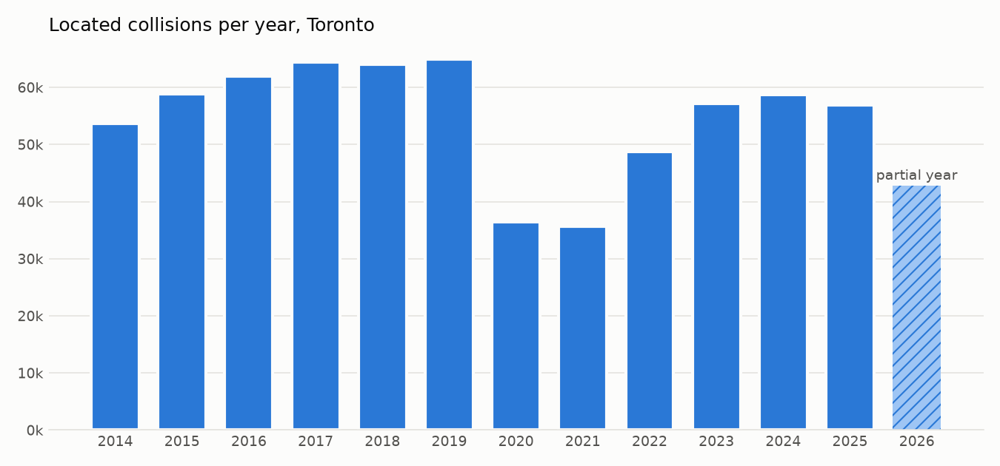
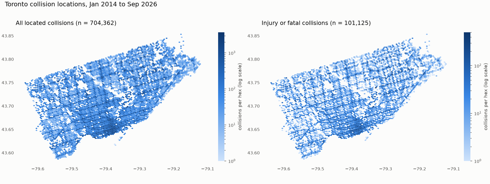

# Collision data report

Source: Toronto Police Service, Traffic Collisions open data (ArcGIS FeatureServer), Open Government Licence - Toronto.

## Row accounting

| step | rows | share of raw |
|---|---:|---:|
| raw download (matches service `returnCountOnly`) | 841,092 | 100% |
| dropped: duplicate EVENT_UNIQUE_ID | 0 | 0.00% |
| dropped: missing / zero coordinates | 136,730 | 16.26% |
| dropped: outside Toronto bbox (non-zero) | 0 | 0.00% |
| **clean, located events** | **704,362** | **83.74%** |

Duplicates: 0 rows share an EVENT_UNIQUE_ID (0 distinct IDs) after upper-casing and trimming. Rows that agree on date, hour, coordinates, and every flag but carry different IDs: 6,391 extra rows. These are kept: at intersection-level location and hour resolution they are indistinguishable from separate collisions at a busy intersection.

Every record with zero coordinates has HOOD_158 = NSA (no specified address): True.

## Per-year coverage

| year | raw rows | located | % located | % injury/fatal | fatal events | % VRU | months | last date | partial |
|---:|---:|---:|---:|---:|---:|---:|---:|---:|---:|
| 2014 | 64,596 | 53,611 | 83.0 | 14.3 | 48 | 6.0 | 12 | 2014-12-31 |  |
| 2015 | 67,265 | 58,853 | 87.5 | 15.6 | 62 | 5.8 | 12 | 2015-12-31 |  |
| 2016 | 69,669 | 62,010 | 89.0 | 16.7 | 74 | 5.5 | 12 | 2016-12-31 |  |
| 2017 | 74,209 | 64,401 | 86.8 | 16.1 | 58 | 5.0 | 12 | 2017-12-31 |  |
| 2018 | 79,271 | 64,077 | 80.8 | 14.2 | 65 | 4.5 | 12 | 2018-12-31 |  |
| 2019 | 82,832 | 64,988 | 78.5 | 12.2 | 59 | 4.0 | 12 | 2019-12-31 |  |
| 2020 | 44,738 | 36,415 | 81.4 | 12.6 | 38 | 5.6 | 12 | 2020-12-31 |  |
| 2021 | 43,745 | 35,699 | 81.6 | 13.2 | 57 | 5.6 | 12 | 2021-12-31 |  |
| 2022 | 59,173 | 48,707 | 82.3 | 11.1 | 43 | 4.7 | 12 | 2022-12-31 |  |
| 2023 | 67,544 | 57,150 | 84.6 | 13.3 | 44 | 5.0 | 12 | 2023-12-31 |  |
| 2024 | 70,181 | 58,717 | 83.7 | 15.6 | 43 | 5.3 | 12 | 2024-12-31 |  |
| 2025 | 67,551 | 56,969 | 84.3 | 15.2 | 39 | 5.2 | 12 | 2025-12-31 |  |
| 2026 | 50,318 | 42,765 | 85.0 | 15.1 | 35 | 5.1 | 9 | 2026-09-30 | **yes** |

VRU = pedestrian, cyclist, or motorcyclist involved. Partial years have fewer than 12 months of records and must be excluded from full-year labels.

## Severity (clean rows)

- injury or fatal: 101,125 (14.4%)
- fatal events: 665; total fatalities 682
- fatal events without INJURY_COLLISIONS = YES: 662 (so severity is defined as injury OR fatalities > 0)
- road-user flags not recorded (N/R or empty): 4,541

## Things to watch

- **Missing location is not random.** Share of records without coordinates: 16.8% of property-damage / other collisions, 12.6% of injury-or-fatal, 4.3% of fatal. Located data over-represents severe collisions relative to the full record.
- **Locations are heavily quantised.** 704,362 located events sit on only 18,651 distinct coordinate pairs (37.8 events per point; the busiest point has 2,890). This is consistent with offsetting to the nearest intersection and is checked against the road graph in CP2. The top 1,000 points hold 53% of all located events. Some of the busiest points sit at shopping-centre parking lots (near Yorkdale and Scarborough Town Centre) with very low severity and high fail-to-remain shares; they may not lie on the drivable network at all.
- **2020-2021 COVID dip.** Located counts fall sharply from April 2020 and recover through 2022.

## Figures

