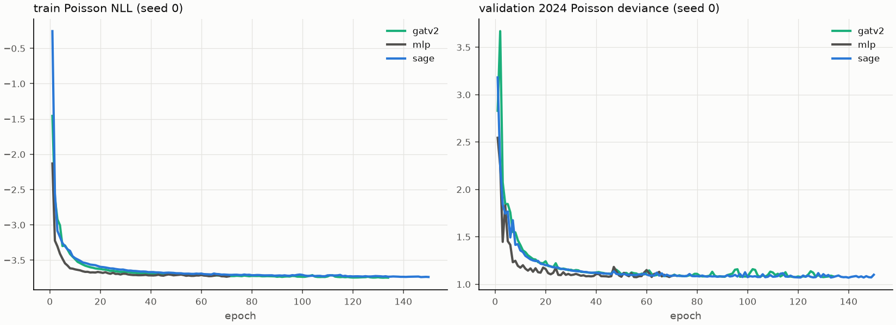

# Graph neural networks on the intersection graph (CP8)

## Graph

- Nodes: 22,435 consolidated intersections; undirected edges: 33,168 (road segments joining two different intersections, one per pair); 50 node features (the LightGBM + AADT set, class combo one-hot, standardised on clean train years) and 6 edge features (class rank, length, lanes, speed limit, log AADT, motorway flag).
- One snapshot per label year (2016, 2017, 2018, 2019, 2022, 2023, 2024, 2025); same topology, year-specific history features and labels. Proxy intersections are never in the loss or the headline numbers.

## Training

Poisson NLL on log expected crashes; full batch, one step per train-year snapshot per epoch; early stopping on validation-2024 deviance (patience 15, at most 150 epochs). Grid on validation only: hidden {64, 128} x layers {2, 3} x lr {1e-3, 3e-3} x dropout {0.1, 0.3} per model. Device: mps. Final configs, 5 seeds each; a model's prediction is the mean of its 5 seeds' expected counts.

| model | hidden | layers | lr | dropout |
|---|---:|---:|---:|---:|
| GATv2 | 128 | 2 | 0.003 | 0.3 |
| MLP (no graph) | 128 | 2 | 0.003 | 0.1 |
| GraphSAGE | 128 | 3 | 0.001 | 0.3 |

Seed variance:

| model | val deviance, mean ± sd | test Spearman, mean ± sd | test deviance, mean ± sd | 5-seed average: test Spearman | best epochs |
|---|---|---|---|---:|---|
| GATv2 | 1.0728 ± 0.0059 | 0.7404 ± 0.0015 | 1.0467 ± 0.0093 | 0.7414 | 119, 87, 109, 86, 119 |
| MLP (no graph) | 1.0827 ± 0.0065 | 0.7383 ± 0.0014 | 1.0539 ± 0.0282 | 0.7394 | 56, 51, 39, 58, 69 |
| GraphSAGE | 1.0731 ± 0.0078 | 0.7409 ± 0.0024 | 1.0309 ± 0.0204 | 0.7424 | 140, 56, 120, 130, 98 |

Timing, final GraphSAGE config, one seed, full training to early stop:

| device | epochs | seconds per epoch | total seconds | best val deviance |
|---|---:|---:|---:|---:|
| cpu | 150 | 0.607 | 91.073 | 1.069 |
| mps | 150 | 0.307 | 46.041 | 1.069 |

## Val 2024: all intersections

| model | Spearman [95% CI] | PR-AUC | recall@1% | recall@5% [95% CI] | recall@10% | Poisson dev. | pred / obs | per-vehicle CE |
|---|---|---:|---:|---|---:|---:|---:|---:|
| persistence | 0.738 [0.731, 0.745] | 0.856 | 0.252 | 0.556 [0.541, 0.571] | 0.712 | 1.180 | 1.028 | 0.044 |
| LightGBM + AADT | 0.734 [0.728, 0.741] | 0.874 | 0.256 | 0.562 [0.547, 0.578] | 0.716 | 1.062 | 0.992 | 0.042 |
| LightGBM + AADT + neighbours | 0.737 [0.730, 0.744] | 0.875 | 0.255 | 0.562 [0.547, 0.577] | 0.716 | 1.059 | 0.980 | 0.046 |
| EB, recalibrated (routing) | 0.725 [0.718, 0.732] | 0.869 | 0.252 | 0.559 [0.543, 0.574] | 0.714 | 1.138 | 0.972 | 0.038 |
| MLP (no graph) | 0.727 [0.720, 0.734] | 0.870 | 0.258 | 0.563 [0.549, 0.578] | 0.715 | 1.073 | 1.002 | 0.044 |
| GraphSAGE | 0.730 [0.724, 0.737] | 0.872 | 0.258 | 0.563 [0.548, 0.579] | 0.717 | 1.061 | 0.994 | 0.038 |
| GATv2 | 0.730 [0.723, 0.738] | 0.872 | 0.258 | 0.563 [0.548, 0.578] | 0.716 | 1.063 | 0.997 | 0.038 |
| ensemble (best GNN + LightGBM + AADT) | 0.735 [0.728, 0.742] | 0.874 | 0.256 | 0.563 [0.548, 0.578] | 0.716 | 1.048 | 0.990 | 0.039 |

Paired differences (same bootstrap resamples):

| comparison | Spearman | recall@5% |
|---|---|---|
| GraphSAGE − MLP (no graph) | +0.004 [+0.002, +0.005] | +0.000 [-0.001, +0.002] |
| GraphSAGE − LightGBM + AADT | -0.004 [-0.006, -0.002] | +0.001 [-0.001, +0.003] |
| GraphSAGE − LightGBM + AADT + neighbours | -0.006 [-0.008, -0.004] | +0.002 [-0.000, +0.003] |
| ensemble (best GNN + LightGBM + AADT) − LightGBM + AADT | +0.000 [-0.001, +0.001] | +0.000 [-0.001, +0.002] |

## Test 2025: all intersections

| model | Spearman [95% CI] | PR-AUC | recall@1% | recall@5% [95% CI] | recall@10% | Poisson dev. | pred / obs | per-vehicle CE |
|---|---|---:|---:|---|---:|---:|---:|---:|
| persistence | 0.741 [0.734, 0.748] | 0.858 | 0.243 | 0.544 [0.529, 0.558] | 0.702 | 1.193 | 1.061 | 0.049 |
| LightGBM + AADT | 0.744 [0.737, 0.751] | 0.881 | 0.251 | 0.554 [0.540, 0.568] | 0.709 | 1.011 | 1.081 | 0.054 |
| LightGBM + AADT + neighbours | 0.746 [0.739, 0.752] | 0.883 | 0.251 | 0.554 [0.540, 0.568] | 0.710 | 1.002 | 1.082 | 0.057 |
| EB, recalibrated (routing) | 0.733 [0.725, 0.740] | 0.875 | 0.249 | 0.552 [0.537, 0.565] | 0.708 | 1.054 | 1.029 | 0.031 |
| MLP (no graph) | 0.739 [0.732, 0.746] | 0.880 | 0.251 | 0.554 [0.539, 0.567] | 0.709 | 1.041 | 1.121 | 0.094 |
| GraphSAGE | 0.742 [0.735, 0.749] | 0.882 | 0.251 | 0.554 [0.539, 0.567] | 0.709 | 1.019 | 1.099 | 0.091 |
| GATv2 | 0.741 [0.734, 0.748] | 0.881 | 0.251 | 0.554 [0.539, 0.568] | 0.710 | 1.037 | 1.125 | 0.086 |
| ensemble (best GNN + LightGBM + AADT) | 0.745 [0.739, 0.752] | 0.883 | 0.251 | 0.555 [0.540, 0.568] | 0.710 | 0.999 | 1.086 | 0.066 |

Paired differences (same bootstrap resamples):

| comparison | Spearman | recall@5% |
|---|---|---|
| GraphSAGE − MLP (no graph) | +0.003 [+0.002, +0.004] | -0.000 [-0.002, +0.002] |
| GraphSAGE − LightGBM + AADT | -0.002 [-0.003, +0.000] | -0.001 [-0.002, +0.001] |
| GraphSAGE − LightGBM + AADT + neighbours | -0.003 [-0.005, -0.002] | -0.000 [-0.002, +0.001] |
| ensemble (best GNN + LightGBM + AADT) − LightGBM + AADT | +0.001 [+0.001, +0.002] | +0.000 [-0.001, +0.001] |

## Test 2025 subsets

Zero-history intersections (no crash in the prior 3 years):

| model | rows | crashes | Spearman | recall@5% | Poisson dev. | pred / obs |
|---|---:|---:|---:|---:|---:|---:|
| persistence | 9,504 | 1,201 | 0.294 | 0.192 | 0.512 | 0.780 |
| LightGBM + AADT | 9,504 | 1,201 | 0.304 | 0.176 | 0.488 | 1.092 |
| LightGBM + AADT + neighbours | 9,504 | 1,201 | 0.312 | 0.190 | 0.483 | 1.102 |
| EB, recalibrated (routing) | 9,504 | 1,201 | 0.215 | 0.157 | 0.544 | 1.116 |
| MLP (no graph) | 9,504 | 1,201 | 0.283 | 0.172 | 0.509 | 1.324 |
| GraphSAGE | 9,504 | 1,201 | 0.297 | 0.177 | 0.503 | 1.366 |
| GATv2 | 9,504 | 1,201 | 0.293 | 0.152 | 0.504 | 1.318 |
| ensemble (best GNN + LightGBM + AADT) | 9,504 | 1,201 | 0.305 | 0.182 | 0.489 | 1.202 |

Low-volume intersections (bottom 3 entering-AADT deciles):

| model | rows | crashes | Spearman | recall@5% | Poisson dev. | pred / obs |
|---|---:|---:|---:|---:|---:|---:|
| persistence | 6,721 | 2,237 | 0.390 | 0.308 | 0.802 | 0.998 |
| LightGBM + AADT | 6,721 | 2,237 | 0.391 | 0.308 | 0.761 | 1.030 |
| LightGBM + AADT + neighbours | 6,721 | 2,237 | 0.394 | 0.307 | 0.757 | 1.040 |
| EB, recalibrated (routing) | 6,721 | 2,237 | 0.379 | 0.312 | 0.779 | 1.022 |
| MLP (no graph) | 6,721 | 2,237 | 0.378 | 0.300 | 0.779 | 1.085 |
| GraphSAGE | 6,721 | 2,237 | 0.386 | 0.308 | 0.772 | 1.087 |
| GATv2 | 6,721 | 2,237 | 0.384 | 0.302 | 0.776 | 1.055 |
| ensemble (best GNN + LightGBM + AADT) | 6,721 | 2,237 | 0.393 | 0.304 | 0.759 | 1.047 |

## Road features only, unseen 2 km blocks (test 2025)

CP3's 5 spatial folds; each fold's labels never enter the loss or early stopping (fold k + 1 early-stops fold k). Message passing still sees held-out nodes' road features: transductive on features, inductive on labels. No history, no AADT.

| model | Spearman [95% CI] | PR-AUC | recall@1% | recall@5% [95% CI] | recall@10% | Poisson dev. | pred / obs | per-vehicle CE |
|---|---|---:|---:|---|---:|---:|---:|---:|
| LightGBM, road features (CP3) | 0.628 [0.619, 0.637] | 0.794 | 0.192 | 0.478 [0.461, 0.497] | 0.640 | 2.531 | 1.004 | 0.125 |
| MLP, road features | 0.621 [0.612, 0.630] | 0.789 | 0.191 | 0.471 [0.453, 0.488] | 0.635 | 2.658 | 1.046 | 0.099 |
| GraphSAGE, road features | 0.629 [0.620, 0.639] | 0.793 | 0.198 | 0.467 [0.450, 0.486] | 0.643 | 2.518 | 1.045 | 0.083 |

| comparison | Spearman | recall@5% |
|---|---|---|
| GraphSAGE, road features − MLP, road features | +0.009 [+0.005, +0.011] | -0.002 [-0.012, +0.010] |
| GraphSAGE, road features − LightGBM, road features (CP3) | +0.002 [-0.002, +0.006] | -0.010 [-0.022, +0.002] |

## Ensemble weight (validation)

Best graph model on validation: GraphSAGE; log-space weight on it 0.50.

## Conclusions

- **Does message passing help with crash history in the model?** GraphSAGE minus the MLP on the same features, test Spearman: +0.003 [+0.002, +0.004] (better).
- **Against the trees:** GraphSAGE minus LightGBM + AADT: -0.002 [-0.003, +0.000] (no different); minus LightGBM with hand-built neighbour features: -0.003 [-0.005, -0.002] (worse). Ensemble minus LightGBM + AADT: +0.001 [+0.001, +0.002] (better) (weight on the GNN 0.50, chosen on validation).
- **Road features only, unseen blocks:** GraphSAGE 0.629, MLP 0.621, LightGBM 0.628 test Spearman. GraphSAGE minus MLP: +0.009 [+0.005, +0.011]; minus LightGBM: +0.002 [-0.002, +0.006].
- **Per-vehicle calibration** (routing's criterion, mean |log pred/obs| over AADT deciles): validation, recalibrated EB 0.0377; lower: GraphSAGE 0.0375, GATv2 0.0376. Test: recalibrated EB 0.0312, GraphSAGE 0.0911, GATv2 0.0862. Routing stays on recalibrated EB unless you decide otherwise (CP8 decision).
- Test Spearman: GraphSAGE 0.742, LightGBM + AADT 0.744, persistence 0.741.
