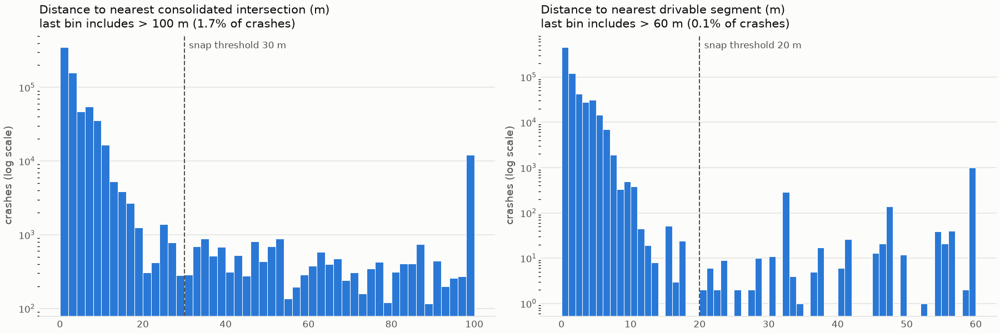
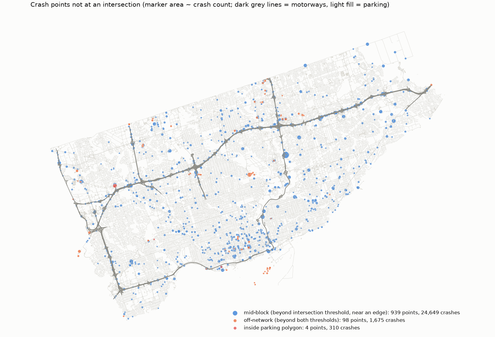

# Crash location analysis

18,651 distinct TPS crash points carrying 704,362 located crashes. Shares are crash-weighted unless marked as points. Intersections are OSMnx-consolidated at tolerance 10 m (nodes within 20 m merge).

## Where crash points sit

| category | crashes | % crashes | points | % points |
|---|---:|---:|---:|---:|
| within 5 m of an intersection | 532,757 | 75.6 | 15,640 | 83.9 |
| within 10 m of an intersection | 645,143 | 91.6 | 17,111 | 91.7 |
| within 20 m of an intersection | 674,869 | 95.8 | 17,522 | 93.9 |
| within 30 m of an intersection | 678,038 | 96.3 | 17,614 | 94.4 |
| within 50 m of an intersection | 683,464 | 97.0 | 17,831 | 95.6 |
| 10-30 m from an intersection | 32,895 | 4.7 | 503 | 2.7 |
| mid-block: <= 20 m from an edge, > 30 m from any intersection | 24,649 | 3.5 | 939 | 5.0 |
| off-network: > 50 m from any drivable edge | 1,101 | 0.2 | 67 | 0.4 |
| inside an OSM parking polygon | 310 | 0.0 | 4 | 0.0 |
| within 25 m of a motorway / ramp | 31,381 | 4.5 | 380 | 2.0 |
| within 25 m of a motorway and > 30 m from any intersection | 6,779 | 1.0 | 223 | 1.2 |

## Reading

- 96.3% of located crashes sit within 30 m of a consolidated intersection (median 2 m). The intersection is the natural unit.
- Mid-block points (> 30 m from an intersection, <= 20 m from an edge) carry 3.5% of crashes on 939 points; 28% of those crashes are within 25 m of a motorway or ramp, and the 20 largest mid-block points hold 34% of them. They look like expressway crashes and a few address-geocoded points, not a systematic mid-block signal.
- Recommendation for CP3: intersection-only labels. Keep mid-block assignments in `crash_assignments.parquet` so a segment model can be added later, but a segment unit would be trained on ~3% of crashes, a large part of which are motorway events whose TPS location is approximate.

## Consolidation tolerance

OSMnx buffers every intersection node by the tolerance and merges overlaps, so the effective merge distance is twice the tolerance.

| tolerance_m | merge_distance_m | intersections | merged_clusters | pct_crashes_within_5m | pct_crashes_within_10m | pct_crashes_within_20m | median_dist_m | clusters_with_2plus_tps_points | pct_crashes_in_those_clusters |
|---:|---:|---:|---:|---:|---:|---:|---:|---:|---:|
| 10 | 20 | 22,435 | 1,497 | 75.6 | 91.6 | 95.8 | 2.0 | 683 | 14.6 |
| 15 | 30 | 21,652 | 2,033 | 71.7 | 86.9 | 94.7 | 2.2 | 950 | 18.2 |
| 20 | 40 | 20,743 | 2,516 | 66.6 | 81.4 | 92.6 | 2.4 | 1,112 | 18.6 |

Chosen: 10 m. A larger tolerance moves cluster centroids away from where TPS places crashes (crashes within 10 m fall as tolerance grows) and folds more distinct TPS points into one cluster; 20 m visibly merges separate intersections (e.g. Dixon Road / Wincott Drive / Northcrest Road / Chetta Place become one node). TPS itself places hundreds of point pairs 10-20 m apart at divided-road intersections, so merging within 20 m matches its own notion of one intersection.

## Snapping thresholds

- Intersection: 30 m. The distance histogram flattens after ~20 m. Of crashes 10-30 m out, 67% are at multi-node (merged) intersections and 73% sit beside a one-way carriageway: divided-road intersections whose TPS point is on one side. Beyond 30 m the counts are flat, i.e. no longer intersection-shaped.
- Mid-block edge: 20 m. 99% of crashes are within 6.4 m of a drivable edge; 20 m leaves room for wide roads while excluding points with no drivable road nearby (Toronto Islands, interiors of large sites).

## Parking

- Points inside an OSM off-street parking polygon: 4.
- Points outside but within 30 m of a lot: 2,624 (27.3% of crashes). Of those, points with >= 100 crashes and >= 35% fail-to-remain: 33 (1.5% of crashes).

## Figures

