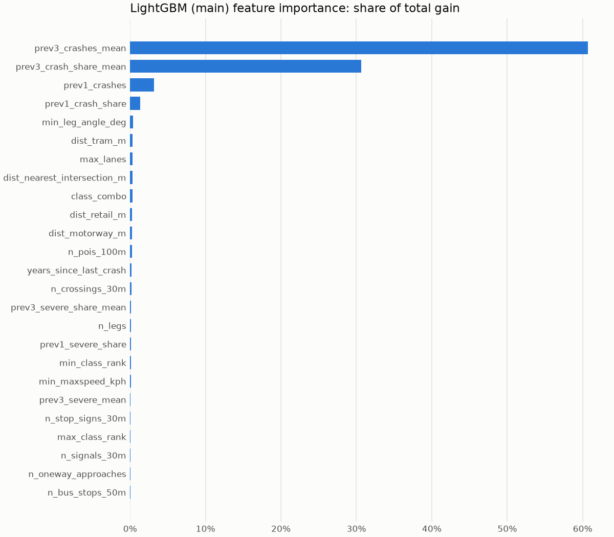

# Model metrics

Unit: consolidated intersection x year. Train label years 2016-2019 + 2022-2023 (134,424 clean rows), validation 2024, test 2025. Headline rows exclude 31 proxy intersections (`reports/excluded_intersections.csv`). Val is used for early stopping and the small hyper-parameter grid, so val numbers are slightly optimistic; test 2025 is untouched. CIs: 1000 bootstrap resamples of intersections; differences are paired (same resamples).

Models: `baseline_prev3_mean` = mean of the 3 prior years; `baseline_persistence` = the intersection's mean over all train label years; `baseline_class_combo` = mean per approach-class combo (no history); `lgbm_main` = static + history; `lgbm_static_only` = static features only, same intersections as train; `lgbm_static_only_spatial` = static only, scored on 2 km spatial blocks the model never saw (5-fold); `lgbm_with_coords` = main + projected x/y (ablation).

Poisson deviance clips predictions at 0.05 crashes/year so baselines that predict exact zeros can be scored; it is a secondary metric here.

## Val 2024 (22,404 clean intersections)

### Any-crash count

| model | Spearman [95% CI] | PR-AUC | ROC-AUC | recall@1% | recall@5% [95% CI] | recall@10% | Poisson dev. | mean pred / obs |
|---|---|---:|---:|---:|---|---:|---:|---|
| baseline_prev3_mean | 0.719 [0.710, 0.727] | 0.823 | 0.857 | 0.254 | 0.559 [0.545, 0.573] | 0.713 | 1.344 | 1.95 / 2.43 |
| baseline_persistence | 0.738 [0.730, 0.745] | 0.856 | 0.886 | 0.252 | 0.556 [0.542, 0.570] | 0.712 | 1.180 | 2.50 / 2.43 |
| baseline_class_combo | 0.395 [0.382, 0.408] | 0.556 | 0.669 | 0.057 | 0.237 [0.224, 0.253] | 0.396 | 5.537 | 2.50 / 2.43 |
| lgbm_main | 0.731 [0.723, 0.738] | 0.872 | 0.891 | 0.254 | 0.562 [0.547, 0.576] | 0.716 | 1.081 | 2.40 / 2.43 |
| lgbm_static_only | 0.726 [0.719, 0.733] | 0.867 | 0.887 | 0.251 | 0.556 [0.542, 0.570] | 0.713 | 1.176 | 2.50 / 2.43 |
| lgbm_static_only_spatial | 0.624 [0.615, 0.633] | 0.792 | 0.827 | 0.198 | 0.485 [0.467, 0.505] | 0.649 | 2.613 | 2.36 / 2.43 |
| lgbm_with_coords | 0.733 [0.725, 0.740] | 0.873 | 0.892 | 0.254 | 0.561 [0.547, 0.575] | 0.717 | 1.074 | 2.39 / 2.43 |
| lgbm_main (all intersections) | 0.732 | 0.873 | 0.891 | 0.261 | 0.572 | 0.724 | 1.092 | 2.46 / 2.52 |

Paired differences vs `baseline_persistence`:

| model | Spearman - baseline_persistence | recall@5% - baseline_persistence |
|---|---|---|
| baseline_prev3_mean | -0.019 [-0.024, -0.015] | +0.003 [-0.000, +0.007] |
| baseline_class_combo | -0.343 [-0.356, -0.331] | -0.319 [-0.337, -0.301] |
| lgbm_main | -0.007 [-0.011, -0.004] | +0.005 [+0.002, +0.009] |
| lgbm_static_only | -0.012 [-0.015, -0.008] | -0.000 [-0.002, +0.001] |
| lgbm_static_only_spatial | -0.114 [-0.121, -0.106] | -0.070 [-0.085, -0.057] |
| lgbm_with_coords | -0.005 [-0.009, -0.002] | +0.005 [+0.002, +0.009] |

### Severe (injury or fatal) count

| model | Spearman [95% CI] | PR-AUC | ROC-AUC | recall@1% | recall@5% [95% CI] | recall@10% | Poisson dev. | mean pred / obs |
|---|---|---:|---:|---:|---|---:|---:|---|
| severe_baseline_prev3_mean | 0.569 [0.555, 0.582] | 0.596 | 0.819 | 0.249 | 0.552 [0.533, 0.572] | 0.711 | 0.665 | 0.25 / 0.39 |
| severe_baseline_persistence | 0.573 [0.561, 0.584] | 0.675 | 0.874 | 0.249 | 0.566 [0.547, 0.584] | 0.736 | 0.545 | 0.36 / 0.39 |
| severe_baseline_class_combo | 0.396 [0.384, 0.407] | 0.384 | 0.784 | 0.059 | 0.260 [0.244, 0.278] | 0.423 | 1.162 | 0.36 / 0.39 |
| lgbm_severe | 0.532 [0.523, 0.541] | 0.747 | 0.916 | 0.261 | 0.582 [0.565, 0.600] | 0.749 | 0.498 | 0.32 / 0.39 |

| model | Spearman - severe_baseline_persistence | recall@5% - severe_baseline_persistence |
|---|---|---|
| severe_baseline_prev3_mean | -0.004 [-0.013, +0.005] | -0.013 [-0.022, -0.005] |
| severe_baseline_class_combo | -0.177 [-0.187, -0.167] | -0.306 [-0.328, -0.285] |
| lgbm_severe | -0.041 [-0.047, -0.034] | +0.017 [+0.009, +0.025] |

## Test 2025 (22,404 clean intersections)

### Any-crash count

| model | Spearman [95% CI] | PR-AUC | ROC-AUC | recall@1% | recall@5% [95% CI] | recall@10% | Poisson dev. | mean pred / obs |
|---|---|---:|---:|---:|---|---:|---:|---|
| baseline_prev3_mean | 0.735 [0.727, 0.743] | 0.839 | 0.872 | 0.251 | 0.553 [0.538, 0.567] | 0.709 | 1.125 | 2.27 / 2.35 |
| baseline_persistence | 0.741 [0.734, 0.748] | 0.858 | 0.889 | 0.243 | 0.544 [0.528, 0.558] | 0.702 | 1.193 | 2.50 / 2.35 |
| baseline_class_combo | 0.396 [0.384, 0.408] | 0.555 | 0.669 | 0.055 | 0.232 [0.219, 0.247] | 0.387 | 5.315 | 2.50 / 2.35 |
| lgbm_main | 0.740 [0.734, 0.747] | 0.879 | 0.898 | 0.251 | 0.554 [0.539, 0.568] | 0.709 | 1.027 | 2.55 / 2.35 |
| lgbm_static_only | 0.728 [0.721, 0.735] | 0.868 | 0.889 | 0.242 | 0.543 [0.526, 0.557] | 0.701 | 1.194 | 2.50 / 2.35 |
| lgbm_static_only_spatial | 0.628 [0.619, 0.636] | 0.794 | 0.829 | 0.192 | 0.478 [0.459, 0.495] | 0.640 | 2.531 | 2.36 / 2.35 |
| lgbm_with_coords | 0.743 [0.736, 0.750] | 0.881 | 0.899 | 0.251 | 0.554 [0.539, 0.568] | 0.708 | 1.017 | 2.55 / 2.35 |
| lgbm_main (all intersections) | 0.742 | 0.880 | 0.898 | 0.261 | 0.567 | 0.718 | 1.036 | 2.62 / 2.44 |

Paired differences vs `baseline_persistence`:

| model | Spearman - baseline_persistence | recall@5% - baseline_persistence |
|---|---|---|
| baseline_prev3_mean | -0.006 [-0.010, -0.001] | +0.010 [+0.006, +0.014] |
| baseline_class_combo | -0.345 [-0.357, -0.333] | -0.311 [-0.330, -0.292] |
| lgbm_main | -0.000 [-0.004, +0.003] | +0.010 [+0.006, +0.015] |
| lgbm_static_only | -0.013 [-0.016, -0.009] | -0.001 [-0.003, +0.001] |
| lgbm_static_only_spatial | -0.113 [-0.121, -0.106] | -0.065 [-0.079, -0.053] |
| lgbm_with_coords | +0.002 [-0.001, +0.006] | +0.010 [+0.007, +0.015] |

### Severe (injury or fatal) count

| model | Spearman [95% CI] | PR-AUC | ROC-AUC | recall@1% | recall@5% [95% CI] | recall@10% | Poisson dev. | mean pred / obs |
|---|---|---:|---:|---:|---|---:|---:|---|
| severe_baseline_prev3_mean | 0.572 [0.559, 0.585] | 0.620 | 0.836 | 0.253 | 0.559 [0.542, 0.577] | 0.714 | 0.577 | 0.31 / 0.37 |
| severe_baseline_persistence | 0.574 [0.562, 0.586] | 0.672 | 0.878 | 0.250 | 0.563 [0.546, 0.581] | 0.726 | 0.529 | 0.36 / 0.37 |
| severe_baseline_class_combo | 0.395 [0.384, 0.406] | 0.383 | 0.786 | 0.057 | 0.254 [0.237, 0.271] | 0.415 | 1.100 | 0.36 / 0.37 |
| lgbm_severe | 0.531 [0.522, 0.540] | 0.743 | 0.919 | 0.257 | 0.573 [0.556, 0.590] | 0.740 | 0.471 | 0.38 / 0.37 |

| model | Spearman - severe_baseline_persistence | recall@5% - severe_baseline_persistence |
|---|---|---|
| severe_baseline_prev3_mean | -0.002 [-0.010, +0.008] | -0.004 [-0.012, +0.004] |
| severe_baseline_class_combo | -0.179 [-0.190, -0.169] | -0.310 [-0.331, -0.289] |
| lgbm_severe | -0.043 [-0.049, -0.036] | +0.009 [+0.003, +0.017] |

## Reading (test 2025)

- `lgbm_main` vs persistence: Spearman -0.000 [-0.004, +0.003]: not distinguishable from; recall@5% +0.010 [+0.006, +0.015]: better than. Absolute recall@5%: 0.554 vs 0.544.
- Severe model vs severe persistence: Spearman -0.043 [-0.049, -0.036]: worse than.
- Static only, seen intersections: Spearman 0.728; unseen spatial blocks: 0.628. The gap is memorisation: continuous static features (distances, counts) act as an intersection fingerprint under a temporal split, so only the spatial number measures transfer to intersections with no crash record.
- Adding coordinates: Spearman 0.743 vs 0.740 without.

## Top 15 features (gain share, `lgbm_main`)

| feature | gain share |
|---|---:|
| prev3_crashes_mean | 60.7% |
| prev3_crash_share_mean | 30.6% |
| prev1_crashes | 3.2% |
| prev1_crash_share | 1.4% |
| min_leg_angle_deg | 0.4% |
| dist_tram_m | 0.3% |
| max_lanes | 0.3% |
| dist_nearest_intersection_m | 0.3% |
| class_combo | 0.3% |
| dist_retail_m | 0.3% |
| dist_motorway_m | 0.3% |
| n_pois_100m | 0.2% |
| years_since_last_crash | 0.2% |
| n_crossings_30m | 0.2% |
| prev3_severe_share_mean | 0.2% |

