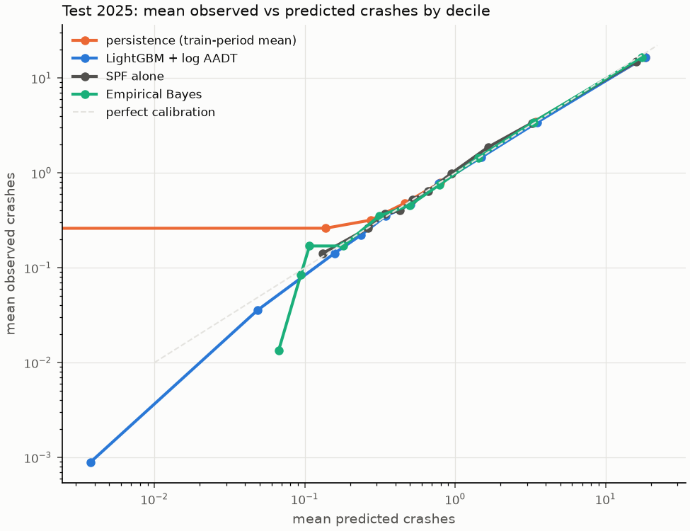

# Model comparison (CP6)

Clean intersections, same metrics and bootstrap as reports/metrics.md (1000 resamples of intersections; paired differences use the same resamples). `SPF alone` is the grouped NB2 SPF with the previous year's citywide level; `Empirical Bayes` blends it with each intersection's previous 5 years (reports/spf.md, reports/eb.md). `LightGBM + log AADT` is the CP3 model plus log entering, major-road and minor-road AADT. Calibration slope: Poisson regression of observed on log(predicted); 1 is ideal, below 1 means the predictions are too spread out.

## Val 2024 (22,404 clean intersections)

| model | Spearman [95% CI] | PR-AUC | recall@1% | recall@5% [95% CI] | Poisson dev. | mean pred / obs | calibration slope |
|---|---|---:|---:|---|---:|---:|---:|
| persistence (train-period mean) | 0.738 [0.731, 0.746] | 0.856 | 0.252 | 0.556 [0.541, 0.570] | 1.180 | 1.028 | 0.963 |
| prev-3 mean | 0.719 [0.711, 0.727] | 0.823 | 0.254 | 0.559 [0.545, 0.574] | 1.344 | 0.805 | 0.964 |
| LightGBM (CP3) | 0.731 [0.724, 0.738] | 0.872 | 0.254 | 0.562 [0.547, 0.575] | 1.081 | 0.988 | 0.989 |
| LightGBM + log AADT | 0.734 [0.728, 0.742] | 0.874 | 0.256 | 0.562 [0.548, 0.576] | 1.062 | 0.992 | 0.985 |
| SPF alone | 0.593 [0.584, 0.603] | 0.765 | 0.198 | 0.488 [0.470, 0.507] | 2.738 | 0.973 | 0.975 |
| Empirical Bayes | 0.725 [0.718, 0.732] | 0.869 | 0.251 | 0.558 [0.544, 0.572] | 1.143 | 0.971 | 0.990 |

Paired differences:

| comparison | Spearman | recall@5% |
|---|---|---|
| EB - persistence | -0.013 [-0.016, -0.010] | +0.002 [-0.001, +0.005] |
| EB - LightGBM + AADT | -0.009 [-0.012, -0.007] | -0.004 [-0.008, -0.002] |
| LightGBM + AADT - persistence | -0.004 [-0.007, -0.000] | +0.006 [+0.003, +0.010] |
| LightGBM (CP3) - LightGBM + AADT | -0.004 [-0.005, -0.003] | -0.001 [-0.003, +0.001] |

## Test 2025 (22,404 clean intersections)

| model | Spearman [95% CI] | PR-AUC | recall@1% | recall@5% [95% CI] | Poisson dev. | mean pred / obs | calibration slope |
|---|---|---:|---:|---|---:|---:|---:|
| persistence (train-period mean) | 0.741 [0.734, 0.748] | 0.858 | 0.243 | 0.544 [0.529, 0.558] | 1.193 | 1.061 | 0.948 |
| prev-3 mean | 0.735 [0.728, 0.743] | 0.839 | 0.251 | 0.553 [0.539, 0.568] | 1.125 | 0.964 | 0.955 |
| LightGBM (CP3) | 0.740 [0.734, 0.747] | 0.879 | 0.251 | 0.554 [0.540, 0.569] | 1.027 | 1.083 | 0.989 |
| LightGBM + log AADT | 0.744 [0.737, 0.750] | 0.881 | 0.251 | 0.554 [0.540, 0.569] | 1.011 | 1.081 | 0.989 |
| SPF alone | 0.595 [0.585, 0.604] | 0.766 | 0.191 | 0.477 [0.459, 0.496] | 2.679 | 1.031 | 0.961 |
| Empirical Bayes | 0.733 [0.726, 0.739] | 0.875 | 0.248 | 0.552 [0.538, 0.566] | 1.058 | 1.029 | 0.987 |

Paired differences:

| comparison | Spearman | recall@5% |
|---|---|---|
| EB - persistence | -0.008 [-0.012, -0.004] | +0.008 [+0.005, +0.012] |
| EB - LightGBM + AADT | -0.011 [-0.014, -0.009] | -0.002 [-0.004, +0.000] |
| LightGBM + AADT - persistence | +0.003 [-0.000, +0.006] | +0.011 [+0.007, +0.014] |
| LightGBM (CP3) - LightGBM + AADT | -0.004 [-0.005, -0.003] | +0.000 [-0.002, +0.002] |

## Reading (test 2025)

- Ranking (Spearman): best is LightGBM + log AADT (0.744); top-5% recall: best is LightGBM + log AADT (0.554).
- Calibration: lowest Poisson deviance is LightGBM + log AADT (1.011); calibration slope closest to 1 is LightGBM (CP3) (0.989); total predicted / observed closest to 1 is Empirical Bayes (1.029, LightGBM + AADT 1.081).
- EB vs persistence: Spearman -0.008 [-0.012, -0.004]: worse than; recall@5% +0.008 [+0.005, +0.012]: better than.
- EB vs LightGBM + AADT: Spearman -0.011 [-0.014, -0.009]: worse than; recall@5% -0.002 [-0.004, +0.000]: not distinguishable from.
- LightGBM + AADT vs CP3 LightGBM: Spearman +0.004 [+0.003, +0.005]: better than.

## Rate hotspots: EB expected crashes per million entering vehicles (2026)

Clean intersections with at least 5,000 entering vehicles a day. `rank by EB count` is the intersection's rank among all intersections by EB expected crashes per year.

| intersection | class combo | EB crashes/yr (2026) | observed/yr 2021-25 | entering AADT | AADT source | EB per MEV | rank by EB count |
|---|---|---:|---:|---:|---|---:|---:|
| Jameson Avenue / Lake Shore Boulevard West | highway x collector | 179.52 | 165.80 | 28,307.56 | blend | 17.37 | 1 |
| Cherry Street / Polson Street | collector x local | 31.57 | 30.20 | 6,220.78 | blend | 13.91 | 300 |
| Grandstand Place / Milepost Place / Thorncliffe Park Drive | collector x local | 52.20 | 50.80 | 11,380.57 | model | 12.57 | 126 |
| Jameson Avenue | highway x collector | 87.53 | 88.20 | 24,643.69 | model | 9.73 | 28 |
| Canadian Road / Warden Avenue | arterial x local | 138.88 | 128.40 | 40,429.81 | blend | 9.41 | 8 |
| Bay Street / Lake Shore Boulevard West | arterial x arterial | 85.72 | 78.00 | 27,377.09 | blend | 8.58 | 30 |
| Lake Shore Boulevard West / Lower Jarvis Street | highway x arterial | 121.41 | 111.40 | 39,114.66 | blend | 8.50 | 13 |
| East Liberty Street / Lynn Williams Street | collector x local | 23.76 | 23.00 | 7,672.74 | blend | 8.48 | 452 |
| Lake Shore Boulevard West / Lower Spadina Avenue / Spadina Avenue | highway x arterial | 156.49 | 143.20 | 54,379.47 | blend | 7.88 | 5 |
| Lake Shore Boulevard West / Yonge Street | arterial x arterial | 79.28 | 72.20 | 27,655.81 | blend | 7.85 | 42 |
| Ashtonbee Road / Thermos Road | collector x local | 22.87 | 21.80 | 8,001.58 | model | 7.83 | 475 |
| Park Lawn Road | arterial x arterial | 66.65 | 61.80 | 23,324.39 | model | 7.83 | 74 |
| Dunn Avenue / Springhurst Avenue | arterial x local | 25.19 | 23.80 | 9,068.29 | blend | 7.61 | 416 |
| Harness Road / Queen's Plate Drive | collector x local | 17.81 | 17.00 | 6,428.05 | blend | 7.59 | 621 |
| Covington Road / Saranac Boulevard | collector x local | 22.67 | 22.60 | 8,218.71 | model | 7.56 | 478 |
| Dufferin Street / Gerry Fitzgerald Drive | arterial x local | 98.66 | 90.40 | 38,134.02 | blend | 7.09 | 19 |
| Allanford Road / Sheppard Avenue East | arterial x local | 60.94 | 56.40 | 23,577.93 | blend | 7.08 | 91 |
| Keele Street / St. Clair Avenue West / Weston Road | arterial x arterial | 105.78 | 96.40 | 43,351.83 | blend | 6.68 | 16 |
| Eglinton Avenue East / Eglinton Avenue West / Yonge Street | arterial x arterial | 69.15 | 62.80 | 28,736.37 | blend | 6.59 | 72 |
| Fenmar Drive / Kenhar Drive | collector x local | 26.41 | 25.60 | 11,746.31 | model | 6.16 | 385 |
