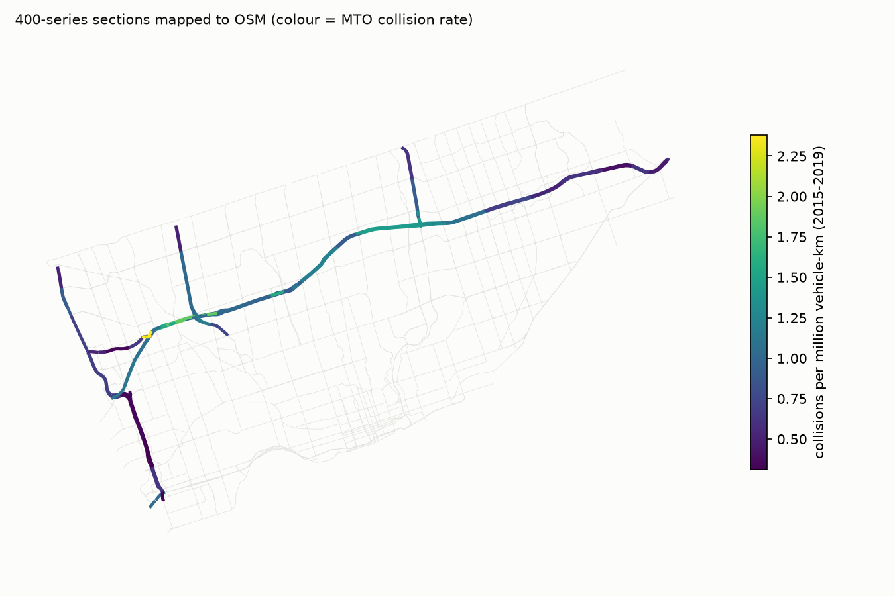

# MTO provincial highway volumes and collision rates (CP5)

## Sources

Ontario Ministry of Transportation, Technical Publications library (https://www.library.mto.gov.on.ca/SydneyPLUS/TechPubs/Portal/tp/tvSplash.aspx), Open Government Licence - Ontario:

- `Traffic_Volumes_1988-2024.csv`: AADT by highway section, 1988-2024.
- `Provincial_Highways_Traffic_Volumes_1988-2021.pdf`: the same sections with total reportable collisions and collision rate (CR, collisions per million vehicle-km; ramp collisions excluded) for 1988-2019 and 2021. 9,463 section-year rows parsed for these highways. MTO did not publish 2020 and has not published rates after 2021.
- The Ontario Data Catalogue `traffic-volume` dataset (1371_traffic_volumes.csv) stops in 2010 and has no collision data, so it is not used.

## Method

- Each section is named after one interchange. The interchange is located on the OSM graph as the point of the highway closest to the crossing road (crosswalk in `src/safepath/data/mto.py`; crossings farther than 400 m are rejected).
- Whether a section runs from its named interchange or to it differs between highways, so each highway uses the convention under which the straight-line spacing of located interchanges best matches the MTO section lengths (median |log ratio| below).
- OSM mainline motorway segments (`highway=motorway`, named after the highway, collector and express lanes included) are assigned to the section whose interchange interval contains their midpoint. Ramps (`motorway_link`) are not assigned: MTO rates exclude ramps.
- Collision rate = collisions / MVKM pooled over 2015-2019 (MVKM = AADT x 365 x section km / 1e6, as MTO defines it); 2021 shown for comparison. AADT is the latest year.

## Per highway (sections that touch Toronto)

| highway | sections | MTO km | OSM carriageway km | AADT 2024 (length-wtd) | AADT min | AADT max | collisions/yr 2015-19 | CR 2015-19 | CR 2021 | naming rule |
|---|---:|---:|---:|---:|---:|---:|---:|---:|---:|---|
| 400 | 4 | 8.11 | 16.23 | 217,567.07 | 54,500.00 | 272,700.00 | 497.80 | 0.86 | 0.74 | start |
| 401 | 24 | 42.91 | 155.90 | 350,703.46 | 274,000.00 | 429,400.00 | 5,316.40 | 1.02 | 0.91 | end |
| 404 | 3 | 5.23 | 11.14 | 265,273.51 | 240,900.00 | 369,900.00 | 440.20 | 0.92 | 0.66 | start |
| 409 | 4 | 3.53 | 8.28 | 98,892.21 | 84,500.00 | 129,400.00 | 85.00 | 0.75 | 0.71 | start |
| 427 | 10 | 18.08 | 44.22 | 255,011.01 | 128,400.00 | 448,300.00 | 726.80 | 0.50 | 0.31 | start |
| QEW | 1 | 0.64 | 1.41 | 184,000.00 | 184,000.00 | 184,000.00 | 41.20 | 1.02 | 0.50 | single |

Province-wide freeway CR from the same publication: 0.6 (2015-2019), 0.4 (2021). Above it in Toronto: 400, 401, 404, 409, QEW; below: 427. For comparison, the TPS-derived motorway rate used in CP4 was 1.15 crashes/km/yr, i.e. roughly 1.15 / (0.365 x AADT/1000) per MVKM; at a 400-series AADT of 300,000 that is ~0.01 per MVKM, two orders of magnitude below MTO's figure, which is the undercount Phase 2 fixes.

## Interchange location and naming convention

| highway | rule | median |log(OSM spacing / MTO km)| if 'end' | ... if 'start' | interchanges located | median crossing gap m |
|---|---|---:|---:|---:|---:|
| 400 | start | 0.89 | 0.07 | 5 | 0.00 |
| 401 | end | 0.02 | 0.39 | 25 | 0.00 |
| 404 | start | 0.43 | 0.02 | 4 | 0.00 |
| 409 | start | 0.80 | 0.01 | 4 | 0.00 |
| 427 | start | 0.48 | 0.02 | 10 | 0.00 |
| QEW | single | nan | nan | 1 | 0.00 |

49 interchanges located. OSM mainline km on the six highways not assigned to any section: 0.0. `mapped_km` counts every carriageway (the 401 has four through Toronto: collector and express each way) and is lumpy because a long OSM motorway segment goes wholly to the section holding its midpoint. The 401 west of the 427 and the 400/404/427 north of Steeles lie outside the City graph. Sections with no published rate (the 427 Finch Ave Ext section, resplit after 2010) take their highway's pooled rate (`cr_source`).

## Sections

| hwy | lhrs | description | length_km | mapped_km | aadt_2024 | collisions_per_year | cr | cr_2021 | cr_source |
|---|---:|---|---:|---:|---:|---:|---:|---:|---|
| 400 | 46,795 | MAPLE LEAF DR-NORTH YORK | 0.44 | 2.17 | 54,500.00 | 6.80 | 0.74 | 0.50 | section |
| 400 | 46,800 | JANE ST IC-20-NORTH YORK | 1.17 | 1.90 | 81,500.00 | 39.60 | 1.16 | 0.90 | section |
| 400 | 46,810 | HWY 401-M/C FRWY IC-21-NORTH YORK | 4.41 | 8.76 | 243,900.00 | 361.80 | 1.01 | 0.90 | section |
| 400 | 46,815 | FINCH AV IC 25-NORTH YORK | 2.09 | 3.40 | 272,700.00 | 89.60 | 0.50 | 0.40 | section |
| 401 | 47,667 | DIXON RD IC-354-ETOBICOKE | 2.41 | 4.97 | 274,000.00 | 268.40 | 1.12 | 1.20 | section |
| 401 | 47,663 | ISLINGTON AV IC-356-ETOBICOKE | 2.43 | 6.13 | 423,000.00 | 377.20 | 1.08 | 1.00 | section |
| 401 | 47,661 | WESTON RD IC-357-NORTH YORK | 1.37 | 6.05 | 427,800.00 | 320.40 | 1.55 | 1.60 | section |
| 401 | 47,660 | HWY 400 IC-359-NORTH YORK | 1.45 | 5.47 | 429,400.00 | 415.20 | 1.88 | 1.80 | section |
| 401 | 47,656 | KEELE ST IC-362-NORTH YORK | 3.05 | 10.27 | 416,100.00 | 447.00 | 1.01 | 1.00 | section |
| 401 | 47,654 | DUFFERIN ST IC-364-NORTH YORK | 1.95 | 11.21 | 411,900.00 | 270.60 | 0.97 | 0.90 | section |
| 401 | 47,652 | ALLEN RD IC-365-NORTH YORK | 0.76 | 1.21 | 425,000.00 | 168.60 | 1.57 | 1.10 | section |
| 401 | 47,650 | BATHURST ST IC-366-NORTH YORK | 1.40 | 5.60 | 395,300.00 | 167.80 | 0.90 | 0.70 | section |
| 401 | 47,647 | AVENUE RD IC-367-NORTH YORK | 1.08 | 7.40 | 362,900.00 | 164.40 | 1.19 | 1.00 | section |
| 401 | 47,643 | HWY 11 IC-369-YONGE ST-NORTH YORK | 1.72 | 3.76 | 363,300.00 | 266.40 | 1.22 | 1.20 | section |
| 401 | 47,642 | BAYVIEW AV IC-371-NORTH YORK | 2.03 | 10.15 | 359,100.00 | 235.60 | 0.91 | 0.80 | section |
| 401 | 47,640 | LESLIE ST IC-373-NORTH YORK | 1.95 | 8.12 | 351,400.00 | 356.20 | 1.47 | 1.40 | section |
| 401 | 47,635 | HWY 404 IC-375-DON VALLEY PKWY-NORTH YORK | 2.02 | 7.24 | 356,100.00 | 369.40 | 1.44 | 1.20 | section |
| 401 | 47,633 | VICTORIA PARK AV IC-376-SCARBOROUGH | 1.44 | 4.39 | 336,900.00 | 231.40 | 1.32 | 0.80 | section |
| 401 | 47,631 | WARDEN AV IC-378-SCARBOROUGH | 1.28 | 8.23 | 341,500.00 | 170.40 | 1.08 | 0.80 | section |
| 401 | 47,629 | KENNEDY RD IC-379-SCARBOROUGH | 1.63 | 6.19 | 363,300.00 | 226.20 | 1.07 | 0.80 | section |
| 401 | 47,628 | BRIMLEY RD IC-380 | 1.65 | 5.22 | 365,400.00 | 141.40 | 0.69 | 0.70 | section |
| 401 | 47,627 | MCCOWAN RD IC-381-SCARBOROUGH | 0.81 | 3.99 | 345,800.00 | 72.60 | 0.74 | 0.70 | section |
| 401 | 47,626 | HWY 48 IC-383-MARKHAM RD-SCARBOROUGH | 1.64 | 5.90 | 302,400.00 | 142.60 | 0.81 | 0.80 | section |
| 401 | 47,625 | NEILSON RD IC-385 | 1.80 | 6.21 | 320,100.00 | 97.60 | 0.51 | 0.50 | section |
| 401 | 47,624 | MORNINGSIDE AV IC-387-SCARBOROUGH | 1.52 | 8.29 | 320,700.00 | 95.40 | 0.61 | 0.40 | section |
| 401 | 47,622 | MEADOWVALE RD IC-389-SCARBOROUGH | 2.49 | 6.98 | 278,700.00 | 88.00 | 0.39 | 0.30 | section |
| 401 | 47,614 | 401-HWY 2 KINGSTON RD IC 392 | 1.33 | 10.36 | 277,800.00 | 74.60 | 0.63 | 0.50 | section |
| 401 | 47,612 | WHITES RD IC-394-REG RD 38-PICKERING | 3.71 | 2.56 | 279,200.00 | 149.00 | 0.45 | 0.30 | section |
| 404 | 48,450 | HWY 401 IC 56-DON VALLEY PKWY | 0.92 | 2.33 | 369,900.00 | 157.00 | 1.40 | 0.70 | section |
| 404 | 48,459 | SHEPPARD AV IC 18-NORTH YORK | 2.12 | 4.74 | 245,200.00 | 168.60 | 0.92 | 0.90 | section |
| 404 | 48,469 | FINCH AV IC 20-NORTH YORK | 2.19 | 4.06 | 240,900.00 | 114.60 | 0.62 | 0.40 | section |
| 409 | 48,980 | HWY 401-ETOBICOKE | 0.36 | 1.02 | 129,400.00 | 37.20 | 2.38 | 1.60 | section |
| 409 | 48,983 | KIPLING AV IC-ETOBICOKE | 1.08 | 2.60 | 84,500.00 | 21.20 | 0.66 | 0.50 | section |
| 409 | 48,986 | MARTIN GROVE RD IC-ETOBICOKE | 1.50 | 2.99 | 100,800.00 | 15.80 | 0.35 | 0.50 | section |
| 409 | 48,990 | ATTWELL DR IC-ETOBICOKE | 0.60 | 1.67 | 101,800.00 | 10.80 | 0.53 | 0.80 | section |
| 427 | 50,205 | EVANS AV IC-ETOBICOKE | 0.34 | 1.15 | 250,500.00 | 7.80 | 0.33 | 0.10 | section |
| 427 | 50,210 | QEW IC START OF COMPLEX FREEWAY | 1.76 | 6.15 | 442,800.00 | 161.00 | 0.63 | 0.50 | section |
| 427 | 50,219 | HWY 5 IC-DUNDAS ST-ETOBICOKE | 1.95 | 8.40 | 442,800.00 | 88.60 | 0.31 | 0.20 | section |
| 427 | 50,260 | BURNHAMTHORPE RD IC-ETOBICOKE | 1.01 | 3.65 | 448,300.00 | 55.20 | 0.37 | 0.20 | section |
| 427 | 50,280 | RATHBURN RD IC-ETOBICOKE | 2.59 | 8.54 | 375,400.00 | 115.00 | 0.35 | 0.30 | section |
| 427 | 50,300 | HWY 401 IC | 2.47 | 4.67 | 146,800.00 | 92.20 | 0.69 | 0.50 | section |
| 427 | 50,310 | DIXON RD IC-ETOBICOKE | 1.28 | 3.24 | 150,100.00 | 42.80 | 0.70 | 0.40 | section |
| 427 | 50,320 | HWY 409 IC-ETOBICOKE | 2.57 | 2.61 | 129,800.00 | 88.40 | 0.71 | 0.40 | section |
| 427 | 50,350 | REXDALE BV IC-ETOBICOKE | 1.83 | 3.11 | 150,900.00 | 75.80 | 0.91 | 0.30 | section |
| 427 | 50,355 | FINCH AV EXT IC-ETOBICOKE | 2.29 | 2.70 | 128,400.00 | nan | 0.50 | nan | highway pooled |
| QEW | 10,155 | EVANS AV IC-138 | 0.64 | 1.41 | 184,000.00 | 41.20 | 1.02 | 0.50 | section |

