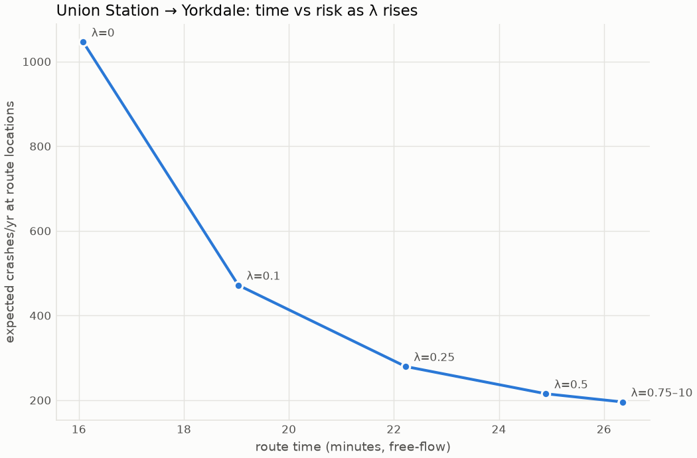
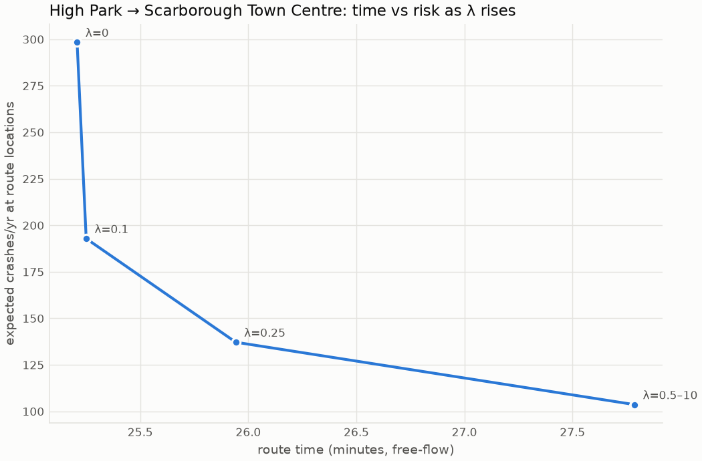

# Routing trade-off

Edge cost = travel_time (s, free-flow OSMnx speeds) + λ · k · risk, where risk is expected crashes per year at the edge's location (intersection entered + segment).

## Scaling constant k

k = **6.8 seconds per (crash/yr)**. Chosen as a fixed point over 200 random origin/destination pairs (3-25 km apart, seed 7): starting from the fastest routes, re-route at λ = 1 and set k = median travel time / median route risk until it moves less than 1%. Check: on the final λ = 1 routes, median risk cost / median travel time = 1.000. So λ = 1 means 'a typical route's risk is weighted as much as its travel time'.

| iteration | k | on |
|---:|---:|---|
| 0 | 2.0 | fastest routes |
| 1 | 6.8 | lambda=1 routes |
| 2 | 6.8 | lambda=1 routes |

## Trade-off over 200 random pairs

| lam | median extra min | p90 extra min | median % risk reduction | p90 % risk reduction | median detour (km ratio) | p90 detour (km ratio) | motorway share | residential share |
|---:|---:|---:|---:|---:|---:|---:|---:|---:|
| 0.00 | 0.00 | 0.00 | 0.00 | 0.00 | 1.00 | 1.00 | 0.50 | 0.03 |
| 0.50 | 3.14 | 7.12 | 67.48 | 83.18 | 1.11 | 1.53 | 0.59 | 0.18 |
| 1.00 | 4.94 | 9.70 | 72.06 | 84.53 | 1.20 | 1.65 | 0.59 | 0.21 |
| 2.00 | 6.36 | 13.04 | 74.73 | 85.74 | 1.26 | 1.81 | 0.58 | 0.23 |

Detour = route km / fastest-route km. Shares are mean fractions of route km on motorways (incl. ramps) and on residential streets; λ = 0 values are in the Pareto tables below via the fastest route.

Mean routing time: 13 ms per route (scipy Dijkstra).

## Things to watch

- Residential share of route km rises from 3% at λ = 0 to 21% at λ = 1: safer routes cut through local streets, whose small intersections carry little predicted risk, to avoid large arterial intersections.
- Motorway share rises from 50% to 59%. Motorway risk is a per-km base rate that is low next to arterial intersections, and most 400-series highways in Toronto are patrolled by the OPP, so TPS data undercounts their crashes. Some safest routes take long motorway detours as a result (worst example below: Union Station to Yorkdale).
- Risk is expected crashes per year at the locations on a route, with no traffic volume term, so a '% risk reduction' means the route avoids crash-prone places, not that a driver's own crash probability falls by that much. Travel times are free-flow, which flatters motorways further.

## Pareto sweeps

### union station yorkdale

| lam | minutes | expected_crashes | km | extra_minutes | risk_reduction_pct |
|---:|---:|---:|---:|---:|---:|
| 0.00 | 16.08 | 1046.20 | 12.85 | 0.00 | 0.00 |
| 0.10 | 19.04 | 471.67 | 13.03 | 2.96 | 54.92 |
| 0.25 | 22.22 | 279.66 | 32.23 | 6.14 | 73.27 |
| 0.50 | 24.90 | 215.17 | 37.22 | 8.81 | 79.43 |
| 0.75 | 26.36 | 195.78 | 37.86 | 10.28 | 81.29 |
| 1.00 | 26.36 | 195.78 | 37.86 | 10.28 | 81.29 |
| 1.50 | 26.36 | 195.78 | 37.86 | 10.28 | 81.29 |
| 2.00 | 26.36 | 195.78 | 37.86 | 10.28 | 81.29 |
| 3.00 | 26.36 | 195.78 | 37.86 | 10.28 | 81.29 |
| 5.00 | 26.36 | 195.78 | 37.86 | 10.28 | 81.29 |
| 7.50 | 26.36 | 195.78 | 37.86 | 10.28 | 81.29 |
| 10.00 | 26.36 | 195.78 | 37.86 | 10.28 | 81.29 |

### high park scarborough town centre

| lam | minutes | expected_crashes | km | extra_minutes | risk_reduction_pct |
|---:|---:|---:|---:|---:|---:|
| 0.00 | 25.21 | 298.40 | 32.91 | 0.00 | 0.00 |
| 0.10 | 25.25 | 192.88 | 32.91 | 0.04 | 35.36 |
| 0.25 | 25.94 | 137.17 | 33.50 | 0.73 | 54.03 |
| 0.50 | 27.79 | 103.63 | 36.02 | 2.58 | 65.27 |
| 0.75 | 27.79 | 103.63 | 36.02 | 2.58 | 65.27 |
| 1.00 | 27.79 | 103.63 | 36.02 | 2.58 | 65.27 |
| 1.50 | 27.79 | 103.63 | 36.02 | 2.58 | 65.27 |
| 2.00 | 27.79 | 103.63 | 36.02 | 2.58 | 65.27 |
| 3.00 | 27.79 | 103.63 | 36.02 | 2.58 | 65.27 |
| 5.00 | 27.79 | 103.63 | 36.02 | 2.58 | 65.27 |
| 7.50 | 27.79 | 103.63 | 36.02 | 2.58 | 65.27 |
| 10.00 | 27.79 | 103.63 | 36.02 | 2.58 | 65.27 |

### uoft st george pearson area

| lam | minutes | expected_crashes | km | extra_minutes | risk_reduction_pct |
|---:|---:|---:|---:|---:|---:|
| 0.00 | 19.44 | 344.11 | 26.53 | 0.00 | 0.00 |
| 0.10 | 19.98 | 236.39 | 26.54 | 0.54 | 31.30 |
| 0.25 | 19.98 | 236.39 | 26.54 | 0.54 | 31.30 |
| 0.50 | 21.78 | 198.68 | 27.51 | 2.34 | 42.26 |
| 0.75 | 21.78 | 198.68 | 27.51 | 2.34 | 42.26 |
| 1.00 | 21.78 | 198.68 | 27.51 | 2.34 | 42.26 |
| 1.50 | 22.90 | 188.83 | 28.08 | 3.46 | 45.13 |
| 2.00 | 22.90 | 188.83 | 28.08 | 3.46 | 45.13 |
| 3.00 | 22.90 | 188.83 | 28.08 | 3.46 | 45.13 |
| 5.00 | 26.14 | 181.30 | 32.37 | 6.70 | 47.31 |
| 7.50 | 26.14 | 181.30 | 32.37 | 6.70 | 47.31 |
| 10.00 | 26.14 | 181.30 | 32.37 | 6.70 | 47.31 |
