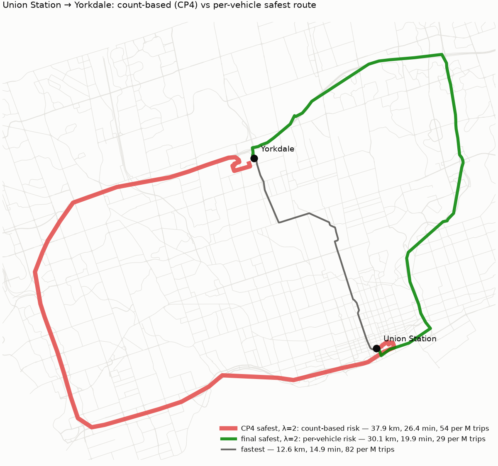
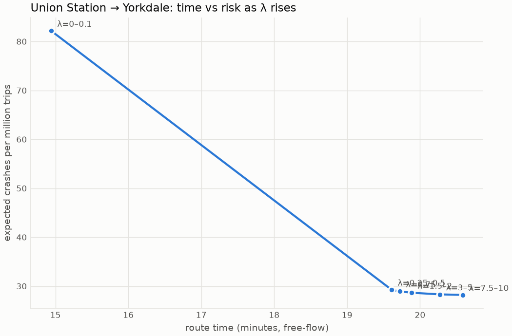
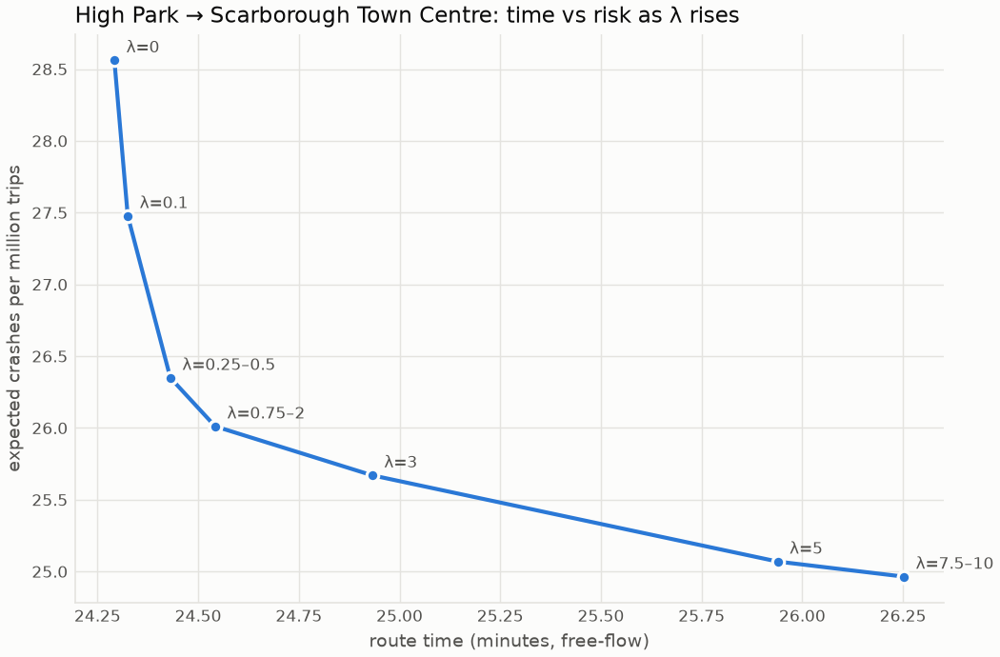
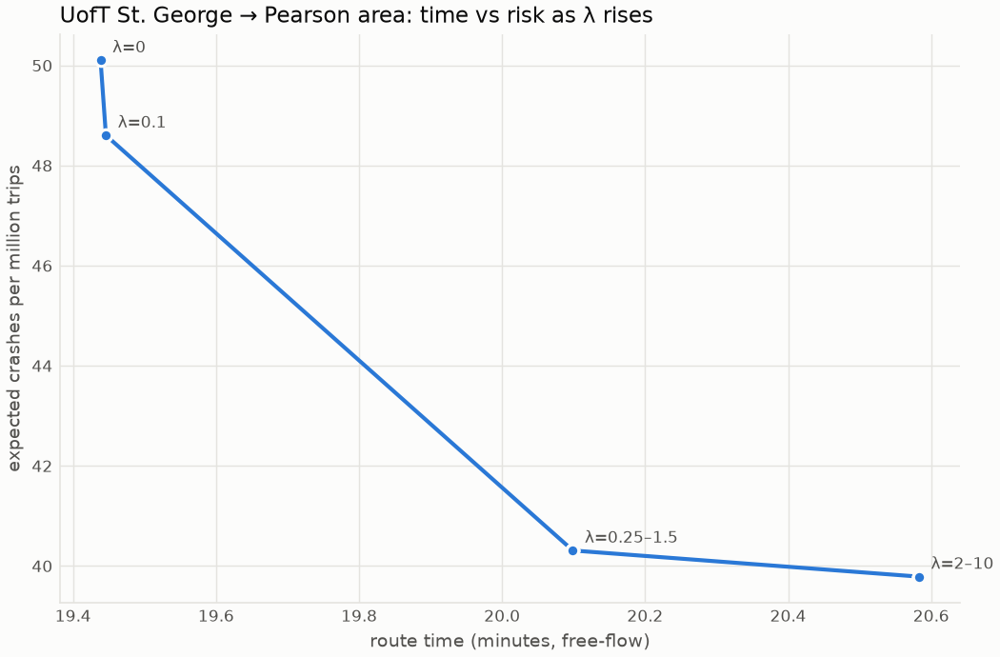

# Routing trade-off (per-vehicle risk, recalibrated)

Edge cost = travel_time (s, free-flow) + λ · k · risk, where risk is the expected number of crashes for one vehicle driving the edge, per million vehicles (reports/risk.md). A route's risk is therefore expected crashes per million trips. Routing is turn-aware: a U-turn (driving back along the edge just used, or turning more than 150° back onto the same street through an intersection) costs 60 s.

## Scaling constant k

k = **30.8 seconds per (crash per million trips)**, the fixed point of k = median travel time / median route risk on λ = 1 routes over 200 random origin/destination pairs (3-25 km apart, seed 7). Check: median risk cost / median travel time on the final λ = 1 routes = 1.000.

| iteration | k | on |
|---:|---:|---|
| 0 | 21.36 | fastest routes |
| 1 | 30.54 | lambda=1 routes |
| 2 | 30.81 | lambda=1 routes |

## Trade-off over 200 random pairs

| lam | median extra min | p90 extra min | median % risk reduction | p90 % risk reduction | median detour (km ratio) | p90 detour (km ratio) | motorway share | residential share | routes with a U-turn |
|---:|---:|---:|---:|---:|---:|---:|---:|---:|---:|
| 0.00 | 0.00 | 0.00 | 0.00 | 0.00 | 1.00 | 1.00 | 0.50 | 0.03 | 0.00 |
| 0.50 | 0.58 | 2.34 | 20.64 | 45.67 | 1.02 | 1.28 | 0.57 | 0.06 | 0.01 |
| 1.00 | 1.43 | 3.47 | 26.31 | 50.24 | 1.04 | 1.44 | 0.58 | 0.08 | 0.03 |
| 2.00 | 2.04 | 5.21 | 28.64 | 52.68 | 1.07 | 1.53 | 0.61 | 0.08 | 0.03 |

Mean routing time: 13 ms per route.

## CP4 vs CP6 vs CP7

CP4 routed on expected crashes per year at the locations a route passes (no exposure); CP6 on per-vehicle risk from EB; CP7 on per-vehicle risk from EB with the volume recalibration (reports/calibration.md). CP4's '% risk reduction' is a different risk measure, so it is not comparable; times, detours and road-class shares are. CP6 numbers are frozen in reports/cp6_baseline.json.

| λ | version | median extra min | p90 extra min | median % risk reduction | median detour (km ratio) | p90 detour (km ratio) | motorway share | residential share |
|---|---|---:|---:|---:|---:|---:|---:|---:|
| 0 | CP4 (count-based) | 0.00 | 0.00 | 0.00 | 1.00 | 1.00 | 0.50 | 0.03 |
| 0 | CP6 (per-vehicle, EB) | 0.00 | 0.00 | 0.00 | 1.00 | 1.00 | 0.50 | 0.03 |
| 0 | CP7 (per-vehicle, recalibrated EB) | 0.00 | 0.00 | 0.00 | 1.00 | 1.00 | 0.50 | 0.03 |
| 0.5 | CP4 (count-based) | 3.14 | 7.12 | 67.48 | 1.11 | 1.53 | 0.59 | 0.18 |
| 0.5 | CP6 (per-vehicle, EB) | 0.58 | 2.30 | 20.99 | 1.02 | 1.28 | 0.57 | 0.06 |
| 0.5 | CP7 (per-vehicle, recalibrated EB) | 0.58 | 2.34 | 20.64 | 1.02 | 1.28 | 0.57 | 0.06 |
| 1 | CP4 (count-based) | 4.94 | 9.70 | 72.06 | 1.20 | 1.65 | 0.59 | 0.21 |
| 1 | CP6 (per-vehicle, EB) | 1.45 | 3.62 | 26.54 | 1.04 | 1.44 | 0.58 | 0.08 |
| 1 | CP7 (per-vehicle, recalibrated EB) | 1.43 | 3.47 | 26.31 | 1.04 | 1.44 | 0.58 | 0.08 |
| 2 | CP4 (count-based) | 6.36 | 13.04 | 74.73 | 1.26 | 1.81 | 0.58 | 0.23 |
| 2 | CP6 (per-vehicle, EB) | 2.04 | 5.09 | 28.73 | 1.07 | 1.52 | 0.60 | 0.08 |
| 2 | CP7 (per-vehicle, recalibrated EB) | 2.04 | 5.21 | 28.64 | 1.07 | 1.53 | 0.61 | 0.08 |

- Residential share at λ = 1: 8% in CP6, 8% after recalibration; the drop from CP4's 21% holds.
- Median risk reduction at λ = 1: 26.5% in CP6, 26.3% now (holds).
- Median extra minutes at λ = 1: 1.45 in CP6, 1.43 now.
- Residential share at λ = 1: 21% in CP4, 8% in CP7 (fastest routes: 3% / 3%).
- Motorway share at λ = 1: 59% in CP4, 58% in CP7 (fastest routes: 50% / 50%).

## Case study: Union Station → Yorkdale at λ = 2

| route | km | minutes | expected crashes per million trips | motorway km |
|---|---:|---:|---:|---:|
| fastest | 12.6 | 14.9 | 82.2 | 3.2 |
| CP4 safest (count-based) | 37.9 | 26.4 | 54.0 | 35.0 |
| CP7 safest (per-vehicle, recalibrated) | 30.1 | 19.9 | 28.7 | 29.3 |
| CP6 safest (as reported in CP6) | 30.1 | 19.9 | 28.8 | 29.3 |

Fastest, CP4 and CP7 rows are scored with CP7 per-vehicle risk. The CP4 route ends at the node CP4 snapped Yorkdale to (a turning circle on Highland Hill, behind the mall).

**The Yorkdale hook.** CP4 snapped the Yorkdale preset (the middle of the mall) to the nearest graph node: a turning circle at the end of Highland Hill, a residential cul-de-sac behind the mall. Every route therefore left the 401 at Dufferin and wound south through Jane Osler, Groton, Bentworth and Ranee before turning back north into the cul-de-sac, which is the hook. It was a snapping artifact, not a routing one: the route had no repeated nodes. Fix: snap like a navigation app (never to a dead end; a point more than 100 m from any street snaps to the nearest arterial or collector access if it is within 150 m of the nearest street), so Yorkdale now snaps to Yorkdale Road. Separately, node-based routing could not see U-turns through divided-road intersections, which per-vehicle routing uses as a cheap way to dodge a risky intersection; routing now runs over turn movements with a U-turn penalty (tests: no immediate reversals; a median U-turn loses to a 30 s detour).

## Sensitivity: is the behaviour robust to the MTO/TPS comparability assumption?

Freeway segment rates (400-series from MTO, city expressways from TPS) scaled by 0.5 and 2; Gardiner/DVP/Allen volumes ±30% (their per-vehicle rate scales by 1/1.3 and 1/0.7). k stays at its baseline value.

| variant | λ | median extra min | median % risk reduction | median detour (km ratio) | motorway share | residential share |
|---|---:|---:|---:|---:|---:|---:|
| baseline | 0.50 | 0.58 | 20.64 | 1.02 | 0.57 | 0.06 |
| baseline | 1.00 | 1.43 | 26.31 | 1.04 | 0.58 | 0.08 |
| baseline | 2.00 | 2.04 | 28.64 | 1.07 | 0.61 | 0.08 |
| freeway rates x0.5 | 0.50 | 0.61 | 23.25 | 1.02 | 0.59 | 0.06 |
| freeway rates x0.5 | 1.00 | 1.40 | 29.87 | 1.05 | 0.62 | 0.07 |
| freeway rates x0.5 | 2.00 | 2.12 | 32.09 | 1.10 | 0.63 | 0.08 |
| freeway rates x2 | 0.50 | 0.68 | 19.97 | 1.02 | 0.54 | 0.07 |
| freeway rates x2 | 1.00 | 1.57 | 22.77 | 1.04 | 0.54 | 0.09 |
| freeway rates x2 | 2.00 | 2.89 | 27.17 | 1.10 | 0.53 | 0.10 |
| Gardiner/DVP/Allen volume +30% | 0.50 | 0.58 | 20.72 | 1.02 | 0.58 | 0.06 |
| Gardiner/DVP/Allen volume +30% | 1.00 | 1.43 | 26.76 | 1.04 | 0.59 | 0.08 |
| Gardiner/DVP/Allen volume +30% | 2.00 | 2.08 | 29.39 | 1.08 | 0.61 | 0.08 |
| Gardiner/DVP/Allen volume -30% | 0.50 | 0.60 | 19.57 | 1.02 | 0.56 | 0.07 |
| Gardiner/DVP/Allen volume -30% | 1.00 | 1.40 | 24.58 | 1.04 | 0.57 | 0.09 |
| Gardiner/DVP/Allen volume -30% | 2.00 | 2.11 | 27.57 | 1.07 | 0.58 | 0.09 |

| variant | Union→Yorkdale λ=2 km | minutes |
|---|---:|---:|
| baseline | 30.1 | 19.9 |
| freeway rates x0.5 | 29.9 | 19.7 |
| freeway rates x2 | 31.1 | 20.8 |
| Gardiner/DVP/Allen volume +30% | 30.1 | 19.9 |
| Gardiner/DVP/Allen volume -30% | 30.6 | 20.3 |

- freeway rates x0.5: motorway share 58% -> 62%, median extra minutes 1.43 -> 1.40, median risk reduction 26% -> 30% (λ = 1).
- freeway rates x2: motorway share 58% -> 54%, median extra minutes 1.43 -> 1.57, median risk reduction 26% -> 23% (λ = 1).
- Gardiner/DVP/Allen volume +30%: motorway share 58% -> 59%, median extra minutes 1.43 -> 1.43, median risk reduction 26% -> 27% (λ = 1).
- Gardiner/DVP/Allen volume -30%: motorway share 58% -> 57%, median extra minutes 1.43 -> 1.40, median risk reduction 26% -> 25% (λ = 1).
- Across all variants at λ = 1 the motorway share spans 8% (54%-62%), against 50% on the fastest routes.
- **Conclusion:** the direction of the behaviour does not depend on the MTO/TPS comparability assumption: halving or doubling every freeway rate still leaves safer routes leaning on freeways (motorway share above the fastest routes' in every variant), and moves extra time and risk reduction by a fraction of their baseline values. The size of the freeway lean does depend on it.

## Things to watch

- Free-flow travel times flatter long freeway detours; congestion would cut them.
- Per-vehicle routing minimises the driver's own risk. It can still send traffic through local streets when they are safer per vehicle, which shifts risk onto pedestrians and residents there (a neighbourhood externality the cost does not include).
- EB overpredicts the quietest intersections (lowest decile, reports/model_comparison.md), so per-vehicle risk on quiet local streets is if anything too high, which works against cut-throughs.

## Pareto sweeps

### union station yorkdale

| lam | minutes | expected_crashes | km | extra_minutes | risk_reduction_pct |
|---:|---:|---:|---:|---:|---:|
| 0.00 | 14.94 | 82.18 | 12.61 | 0.00 | 0.00 |
| 0.10 | 14.94 | 82.18 | 12.61 | 0.00 | 0.00 |
| 0.25 | 19.61 | 29.26 | 29.79 | 4.67 | 64.39 |
| 0.50 | 19.61 | 29.26 | 29.79 | 4.67 | 64.39 |
| 0.75 | 19.72 | 28.93 | 29.93 | 4.78 | 64.80 |
| 1.00 | 19.72 | 28.93 | 29.93 | 4.78 | 64.80 |
| 1.50 | 19.88 | 28.65 | 30.10 | 4.94 | 65.13 |
| 2.00 | 19.88 | 28.65 | 30.10 | 4.94 | 65.13 |
| 3.00 | 20.27 | 28.31 | 30.60 | 5.33 | 65.55 |
| 5.00 | 20.27 | 28.31 | 30.60 | 5.33 | 65.55 |
| 7.50 | 20.59 | 28.21 | 31.07 | 5.64 | 65.68 |
| 10.00 | 20.59 | 28.21 | 31.07 | 5.64 | 65.68 |

### high park scarborough town centre

| lam | minutes | expected_crashes | km | extra_minutes | risk_reduction_pct |
|---:|---:|---:|---:|---:|---:|
| 0.00 | 24.29 | 28.56 | 32.77 | 0.00 | 0.00 |
| 0.10 | 24.33 | 27.48 | 32.77 | 0.03 | 3.80 |
| 0.25 | 24.43 | 26.35 | 32.69 | 0.14 | 7.74 |
| 0.50 | 24.43 | 26.35 | 32.69 | 0.14 | 7.74 |
| 0.75 | 24.54 | 26.01 | 32.83 | 0.25 | 8.93 |
| 1.00 | 24.54 | 26.01 | 32.83 | 0.25 | 8.93 |
| 1.50 | 24.54 | 26.01 | 32.83 | 0.25 | 8.93 |
| 2.00 | 24.54 | 26.01 | 32.83 | 0.25 | 8.93 |
| 3.00 | 24.93 | 25.67 | 33.33 | 0.64 | 10.12 |
| 5.00 | 25.94 | 25.07 | 34.59 | 1.65 | 12.23 |
| 7.50 | 26.25 | 24.96 | 35.05 | 1.96 | 12.59 |
| 10.00 | 26.25 | 24.96 | 35.05 | 1.96 | 12.59 |

### uoft st george pearson area

| lam | minutes | expected_crashes | km | extra_minutes | risk_reduction_pct |
|---:|---:|---:|---:|---:|---:|
| 0.00 | 19.44 | 50.10 | 26.53 | 0.00 | 0.00 |
| 0.10 | 19.45 | 48.60 | 26.50 | 0.01 | 2.99 |
| 0.25 | 20.10 | 40.31 | 27.61 | 0.66 | 19.55 |
| 0.50 | 20.10 | 40.31 | 27.61 | 0.66 | 19.55 |
| 0.75 | 20.10 | 40.31 | 27.61 | 0.66 | 19.55 |
| 1.00 | 20.10 | 40.31 | 27.61 | 0.66 | 19.55 |
| 1.50 | 20.10 | 40.31 | 27.61 | 0.66 | 19.55 |
| 2.00 | 20.58 | 39.79 | 28.02 | 1.14 | 20.59 |
| 3.00 | 20.58 | 39.79 | 28.02 | 1.14 | 20.59 |
| 5.00 | 20.58 | 39.79 | 28.02 | 1.14 | 20.59 |
| 7.50 | 20.58 | 39.79 | 28.02 | 1.14 | 20.59 |
| 10.00 | 20.58 | 39.79 | 28.02 | 1.14 | 20.59 |
