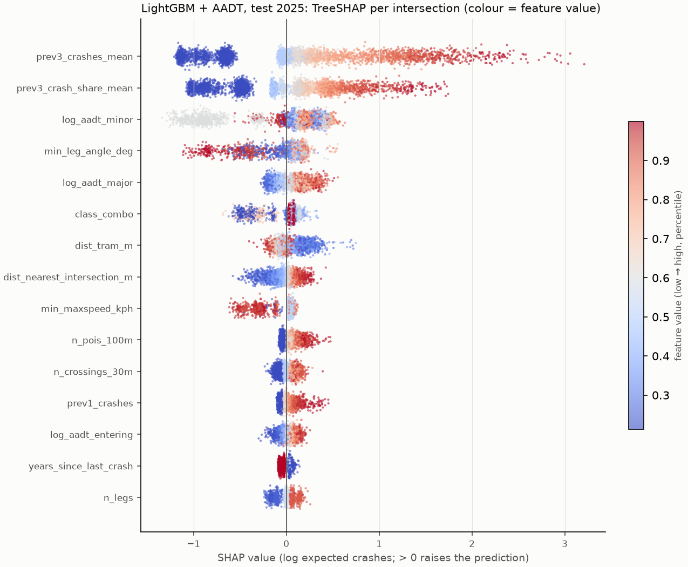
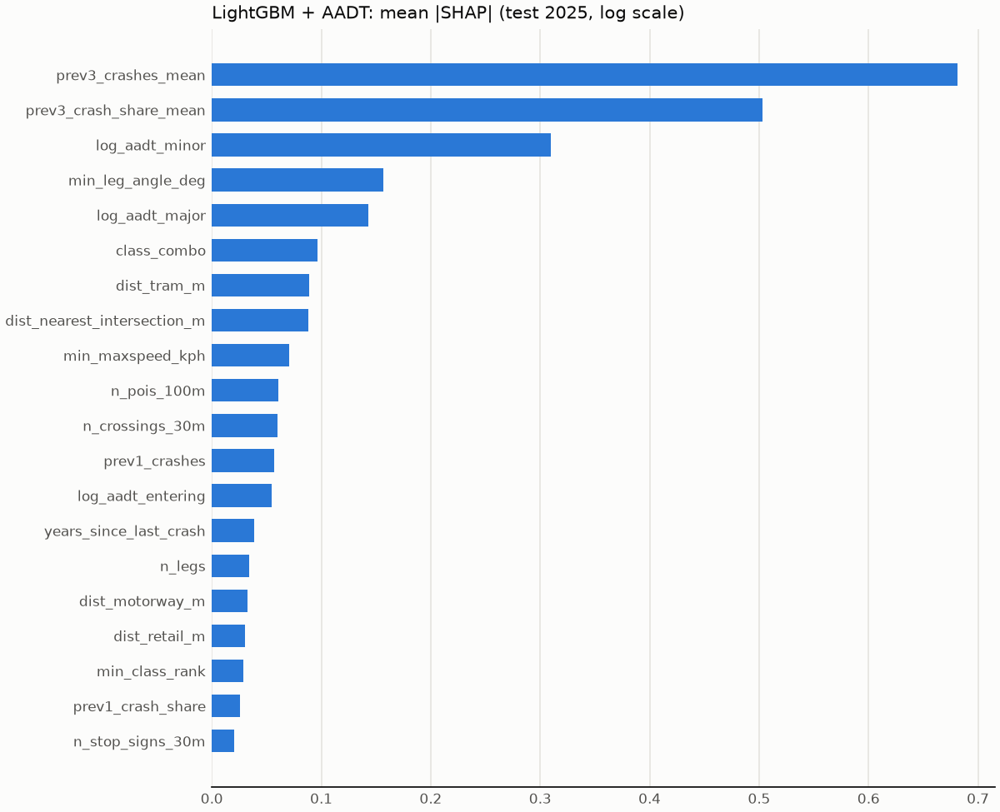

# Explanations (CP7)

## LightGBM + AADT: TreeSHAP

Exact TreeSHAP (LightGBM `pred_contrib`) on 22,404 clean test-2025 intersections; values are on the log scale of expected crashes (Poisson link), so +0.69 doubles a prediction.

History features take 49% of total mean |SHAP|; the three AADT features 19%; static road features the rest.

### Do the learned effects make sense?

Direction = Spearman correlation between a feature's value and its SHAP value.

| feature | mean |SHAP| | rank | value-SHAP Spearman | learned | expected | verdict |
|---|---:|---:|---:|---|---|---|
| prev3_crashes_mean | 0.681 | 1 | 0.956 | + | + (crash history) | as expected |
| log_aadt_minor | 0.310 | 3 | 0.021 | flat | + (busier side road) | weak |
| min_leg_angle_deg | 0.156 | 4 | 0.101 | + | - (skewed intersections are worse) | counterintuitive |
| log_aadt_major | 0.143 | 5 | 0.879 | + | + (busier main road) | as expected |
| dist_tram_m | 0.089 | 7 | -0.556 | - | - (nearer streetcar, more crashes) | as expected |
| n_pois_100m | 0.061 | 10 | 0.858 | + | + (activity, pedestrians) | as expected |
| log_aadt_entering | 0.055 | 13 | 0.835 | + | + (more traffic, more crashes) | as expected |
| n_legs | 0.034 | 15 | 0.828 | + | + (more conflict points) | as expected |
| dist_motorway_m | 0.032 | 16 | 0.565 | + | ? (ramp terminals vs local streets) | as expected |
| max_lanes | 0.020 | 21 | 0.691 | + | + (wider roads, more conflicts) | as expected |
| max_maxspeed_kph | 0.011 | 24 | -0.836 | - | + (faster approach roads) | counterintuitive |
| n_bus_stops_50m | 0.004 | 31 | 0.682 | + | + (stops and pedestrians) | as expected |
| has_signal | 0.002 | 34 | 0.546 | + | + (signals mark busy, complex intersections) | as expected |
| streetcar_20m | 0.000 | 39 | 0.147 | + | + (tracks, stops and turning conflicts) | as expected |

Flagged:

- `log_aadt_minor`: learned flat, expected + (busier side road) (weak).
- `min_leg_angle_deg`: learned +, expected - (skewed intersections are worse) (counterintuitive).
- `max_maxspeed_kph`: learned -, expected + (faster approach roads) (counterintuitive).

Where these come from:

- `log_aadt_minor`: 16% of intersections have a single road (no minor approach); their SHAP averages -0.83, which is most of this feature's importance and is sensible (not a real crossing). Among real crossings the effect rises with minor-road volume (+0.23 Spearman below the top decile) and drops in the top decile (+0.04), where the 'minor' road is an expressway at a ramp or freeway cluster that TPS barely records.
- `max_maxspeed_kph`: the negative effect sits at 100 km/h approaches (mean SHAP -0.084 vs +0.004 at 50 km/h or less): ramp and expressway clusters, again OPP or few recorded crashes. Not evidence that speed is safe; the effect is small.
- `min_leg_angle_deg`: the low-angle end (5% of intersections at 45° or less) has mean SHAP -0.30, but those are mostly carriageway and ramp merges (median entering AADT 28,848 vs 3,144 elsewhere) where TPS records few crashes, not skewed street crossings. The other strongly negative group is the 2% at exactly 180° (one-leg clusters, mean SHAP -0.83), which are not real intersections. Between those ends the value-SHAP Spearman is +0.08. The SPF, which holds legs, signal and volume fixed, gives the expected negative angle effect for unsignalised and 3-leg intersections but a positive one for signalised 4-leg ones (reports/spf.md), so the skew effect is not cleanly identified in this data.

## Routing model (EB): factor breakdown

Routing uses EB, so the app explains the EB number. log(EB) = log(SPF) + log(EB / SPF): the SPF part splits exactly into its terms (coefficients in reports/spf.md), each measured against the citywide average intersection, and log(EB / SPF) is the intersection's own crash history relative to that expectation. The app shows the three largest, with the factor they multiply expected crashes per year by.

Mean |log contribution| over all intersections:

| factor | mean |log contribution| |
|---|---:|
| crash history | 0.880 |
| intersection type | 0.554 |
| traffic volume | 0.547 |
| road classes | 0.287 |
| leg angle | 0.099 |
| legs | 0.038 |
| streetcar | 0.025 |

Traffic volume raises expected crashes per year, but with elasticities below 1 (reports/spf.md) it lowers crashes per vehicle: busier intersections are more dangerous places and less dangerous per car.

## Hand-checked intersections

| intersection | EB crashes/yr (2026) | per million entering vehicles | EB top factors (app) | LightGBM SHAP top 3 (test 2025) |
|---|---:|---:|---|---|
| Dundas Street East / Dundas Street West / Yonge Street | 33.49 | 4.00 | signalised 4+ leg intersection (+, ×18.7); more crashes than expected (2021-25) (+, ×1.3); arterial x arterial roads (+, ×1.3) | prev3_crashes_mean (+2.18), prev3_crash_share_mean (+1.36), n_pois_100m (+0.32) |
| Ellesmere Road / Kennedy Road | 161.69 | 5.64 | signalised 4+ leg intersection (+, ×18.7); more crashes than expected (2021-25) (+, ×3.2); high traffic volume (+, ×2.9) | prev3_crashes_mean (+3.26), prev3_crash_share_mean (+1.73), prev1_crashes (+0.56) |
| Jameson Avenue / Lake Shore Boulevard West | 16.76 | 1.62 | signalised 4+ leg intersection (+, ×18.7); high traffic volume (+, ×2.1); highway x any roads (−, ×0.7) | prev3_crashes_mean (+3.27), prev3_crash_share_mean (+1.66), prev1_crashes (+0.55) |
| Bloor Street West / Spadina Avenue / Spadina Road | 26.44 | 2.58 | signalised 4+ leg intersection (+, ×18.7); high traffic volume (+, ×2.3); fewer crashes than expected (2021-25) (−, ×0.6) | prev3_crashes_mean (+2.20), prev3_crash_share_mean (+1.30), prev1_crashes (+0.21) |

Reading: the EB factors explain the number routing uses; LightGBM's SHAP is dominated by crash history at every busy intersection, which is right but uninformative.
- Yonge / Dundas: a signalised 4+ leg arterial crossing with somewhat more crashes than its volume and design predict. Its per-vehicle risk is moderate because so much traffic passes through; much of its harm is to pedestrians, which per-vehicle routing does not price.
- Ellesmere / Kennedy: among the city's highest crash counts; the factors say why: signalised 4+ leg, high volume, and about three times more crashes than that predicts.
- Jameson / Lake Shore: before attribution it was the city's top intersection; after moving its excess to the Gardiner (reports/risk.md), it is an ordinary busy signalised crossing, and the factors no longer mention its history.
- Bloor / Spadina: busy and signalised, but fewer crashes than expected over 2021-25, so EB pulls it below its SPF.
