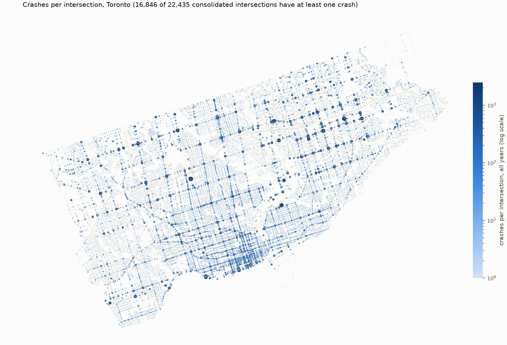

# Snapping report

Every located crash is assigned to a consolidated intersection, a mid-block segment, or excluded (rules in `src/safepath/snapping.py`, thresholds in `configs/default.yaml`).

## Assignments

| unit type | crashes | share |
|---|---:|---:|
| intersection | 678,033 | 96.26% |
| segment | 24,625 | 3.50% |
| excluded | 1,704 | 0.24% |
| **total** | **704,362** | |

Exclusions by reason:

| reason | crashes |
|---|---:|
| beyond_snap_thresholds | 1,394 |
| in_parking | 310 |

## By year

| year | excluded | intersection | segment | % excluded |
|---|---:|---:|---:|---:|
| 2014 | 136 | 51,746 | 1,729 | 0.3 |
| 2015 | 107 | 56,546 | 2,200 | 0.2 |
| 2016 | 140 | 59,624 | 2,246 | 0.2 |
| 2017 | 165 | 61,976 | 2,260 | 0.3 |
| 2018 | 179 | 61,716 | 2,182 | 0.3 |
| 2019 | 171 | 62,708 | 2,109 | 0.3 |
| 2020 | 83 | 35,028 | 1,304 | 0.2 |
| 2021 | 121 | 34,349 | 1,229 | 0.3 |
| 2022 | 116 | 46,854 | 1,737 | 0.2 |
| 2023 | 97 | 55,023 | 2,030 | 0.2 |
| 2024 | 155 | 56,440 | 2,122 | 0.3 |
| 2025 | 132 | 54,829 | 2,008 | 0.2 |
| 2026 | 102 | 41,194 | 1,469 | 0.2 |

## Crashes per intersection

22,435 consolidated intersections; 16,846 have at least one crash in 2014-2026. Quantiles of crashes per intersection (all years, zeros included): p25 = 1, p50 = 5, p75 = 17, p90 = 66, p99 = 475, max = 2,468.

| top intersections | % of intersection crashes | % of all located crashes |
|---|---:|---:|
| 1% (224) | 26.5 | 25.6 |
| 5% (1,122) | 58.1 | 55.9 |
| 10% (2,244) | 73.5 | 70.8 |

## Top 20 intersections

Names are the OSM street names on edges touching the intersection's nodes. Flags: `retail?` = >= 500 crashes, < 6% severe, > 20% fail-to-remain (pattern of parking-lot crashes geocoded to the nearest public intersection); `expressway?` = >= 500 crashes on minor roads only, within 300 m of a motorway (pattern of expressway crashes geocoded to a nearby surface intersection).

| # | crashes | % severe | % FTR | OSM nodes | m to motorway | flag | intersection | road classes |
|---:|---:|---:|---:|---:|---:|---|---|---|
| 1 | 2,468 | 2.7 | 47.8 | 1 | 279 | retail? | Alcester Court / Highland Hill | residential |
| 2 | 2,165 | 3.7 | 47.6 | 2 | 283 | retail? | Borough Drive / Progress Avenue | secondary,secondary_link |
| 3 | 2,124 | 15.2 | 9.0 | 1 | 173 | expressway? | Airley Crescent / Four Oaks Gate | residential |
| 4 | 1,957 | 12.3 | 11.6 | 4 | 5 |  | Lake Shore Boulevard West / Lower Spadina Avenue / Spadina Avenue | motorway_link,primary,secondary |
| 5 | 1,845 | 16.5 | 12.0 | 4 | 840 |  | Ellesmere Road / Kennedy Road | secondary |
| 6 | 1,825 | 5.4 | 38.8 | 4 | 208 | retail? | Parkway Forest Drive / Sheppard Avenue East | residential,secondary |
| 7 | 1,791 | 18.6 | 7.4 | 1 | 56 |  | Laurentide Drive / York Mills Road | residential,secondary |
| 8 | 1,738 | 15.6 | 9.3 | 4 | 3,114 |  | Dufferin Street / Finch Avenue West | secondary |
| 9 | 1,729 | 14.6 | 10.5 | 2 | 6 |  | Jameson Avenue / Lake Shore Boulevard West | motorway_link,primary,tertiary |
| 10 | 1,646 | 13.2 | 8.7 | 1 | 0 |  | Jameson Avenue | motorway_link,primary_link,tertiary |
| 11 | 1,614 | 16.5 | 13.1 | 4 | 744 |  | Ellesmere Road / Markham Road | primary,secondary |
| 12 | 1,501 | 13.1 | 8.9 | 1 | 122 | expressway? | Ferrand Drive / Seton Park Road | residential |
| 13 | 1,486 | 12.4 | 19.7 | 2 | 803 |  | Finch Avenue West / Jane Street | secondary |
| 14 | 1,453 | 15.8 | 13.4 | 4 | 750 |  | Kennedy Road / Sheppard Avenue East | secondary |
| 15 | 1,418 | 17.3 | 11.1 | 5 | 2,720 |  | Kennedy Road / Lawrence Avenue East | secondary,secondary_link |
| 16 | 1,387 | 11.5 | 14.2 | 4 | 164 |  | Bayview Avenue / Sheppard Avenue East | secondary |
| 17 | 1,375 | 5.4 | 24.0 | 1 | 1,057 | retail? | Canadian Road / Warden Avenue | secondary,unclassified |
| 18 | 1,302 | 15.0 | 10.5 | 4 | 749 |  | Ellesmere Road / Warden Avenue | secondary |
| 19 | 1,294 | 16.4 | 12.5 | 5 | 802 |  | Kipling Avenue / Rexdale Boulevard | secondary |
| 20 | 1,270 | 17.9 | 6.9 | 4 | 138 |  | Evans Avenue / Kipling Avenue | secondary |

## Anomalous intersections

- Retail-lot proxies (11, 12,446 crashes): Alcester Court / Highland Hill (2,468); Borough Drive / Progress Avenue (2,165); Parkway Forest Drive / Sheppard Avenue East (1,825); Canadian Road / Warden Avenue (1,375); Sherway Gardens Road / Sherway Gate (936); Eglinton Avenue East / Hakimi Avenue / Lebovic Avenue (815); Daphne Road / Greencedar Circuit (705); Archer Street / Cobourg Avenue (617); Anthony Road / Dufferin Street (517); Bremner Boulevard / York Street (512); Esther Shiner Boulevard / Provost Drive (511).
- Expressway proxies (6, 8,302 crashes): Alcester Court / Highland Hill (2,468); Airley Crescent / Four Oaks Gate (2,124); Ferrand Drive / Seton Park Road (1,501); Sherway Gardens Road / Sherway Gate (936); Concorde Place / Wynford Drive / Wynford Heights Crescent (762); Esther Shiner Boulevard / Provost Drive (511).
- More broadly, 1,400 intersections within 100 m of a motorway or ramp hold 7.2% of intersection crashes (e.g. Lake Shore at Spadina, Jameson, Bay and Jarvis under the Gardiner). Some of these are genuine ramp-terminal crashes; some are expressway crashes placed at the nearest surface point.
- The flags are heuristics: a busy downtown intersection can also show low severity and many hit-and-runs (e.g. Bremner / York), and the two lists overlap.
- Both patterns put risk on an intersection that is not where the crashes happened. They need an explicit decision before CP3 labels are built.

## Arterial sanity check

Rank of the first intersection whose street names contain each arterial.

| street | best rank | in top 100 | in top 500 | intersections on street |
|---|---:|---:|---:|---:|
| Dundas | 86 | 1 | 14 | 242 |
| Eglinton | 28 | 9 | 39 | 254 |
| Finch | 8 | 12 | 42 | 239 |
| Steeles | 117 | 0 | 4 | 217 |
| Sheppard | 6 | 16 | 31 | 206 |
| Lawrence | 15 | 12 | 33 | 288 |

Steeles Avenue is the city's northern boundary; crashes on its north side are York Region's, and TPS covers only the Toronto side, so it ranks lower than its traffic suggests.

