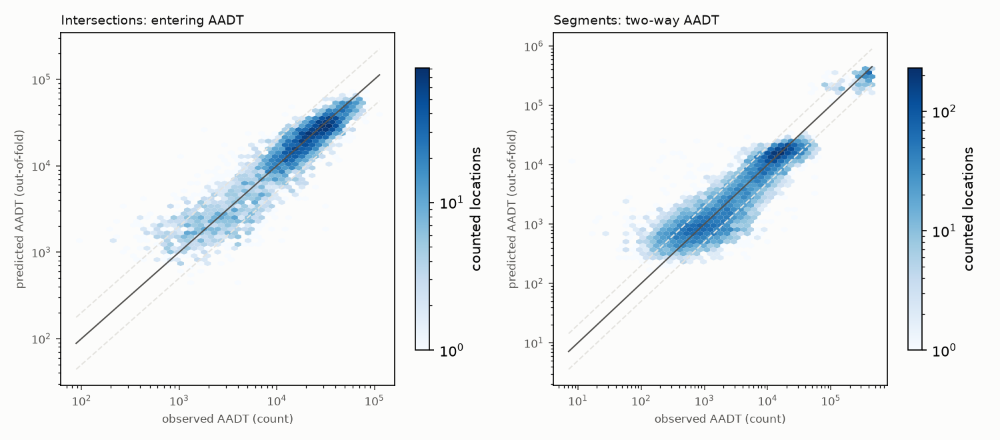
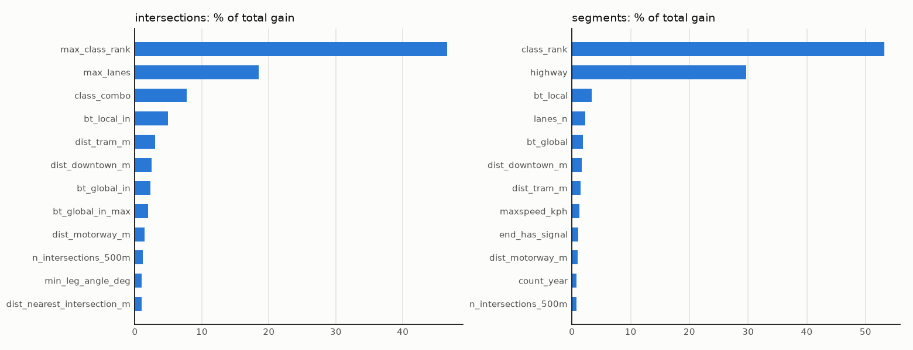

# Traffic volume model (CP5)

Predicts AADT for every consolidated intersection (entering vehicles) and every road segment (two-way vehicles) where the City has no count. `python -m safepath volume-model` regenerates everything here.

## Data

- Targets: log AADT of the most recent count since 2010 (2020-21 left out) at 4,861 intersections (TMC) and 9,645 segments (SVC), plus MTO 2024 AADT on 313 400-series mainline segments. `count_year` is a feature; predictions use `count_year = 2025`.
- Features: the 27 static OSM intersection features from CP3, or segment attributes (class, lanes, speed limit, one-way / divided carriageway, length, endpoint classes and signals, POIs, bus stops, streetcar, motorway and downtown distance, local intersection density), plus sampled **edge betweenness** on free-flow travel time: global (2,000 random sources, all destinations) and local (5,000 sources, destinations within 5 minutes). Intersections use the betweenness summed over entering edges. The implementation is checked exactly against networkx on a random graph (tests/test_centrality.py).
- No coordinates or neighbourhood IDs.

## Spatial-block cross-validation

5 folds of 2 km blocks (as in CP3); each fold early-stops on the next fold and is scored on blocks it never saw. Baseline: median log AADT of the class (intersection class combo / segment highway class) in the training folds. `median abs % error` is |predicted / observed - 1|.

### Intersections (entering AADT)

| class_combo | model | n | rmse_log | median_abs_pct_err | r2_log | bias_log |
|---|---|---:|---:|---:|---:|---:|
| all | baseline | 4,861 | 0.576 | 33.213 | 0.718 | 0.042 |
| all | lgbm | 4,861 | 0.427 | 21.430 | 0.845 | -0.014 |
| arterial x arterial | baseline | 348 | 0.474 | 30.624 | -0.082 | 0.099 |
| arterial x arterial | lgbm | 348 | 0.295 | 17.137 | 0.579 | -0.024 |
| arterial x collector | baseline | 630 | 0.402 | 24.561 | -0.008 | 0.025 |
| arterial x collector | lgbm | 630 | 0.280 | 16.887 | 0.509 | -0.019 |
| arterial x local | baseline | 1,930 | 0.448 | 30.977 | -0.028 | 0.028 |
| arterial x local | lgbm | 1,930 | 0.301 | 17.512 | 0.536 | -0.005 |
| collector x collector | baseline | 183 | 0.606 | 34.503 | -0.054 | 0.110 |
| collector x collector | lgbm | 183 | 0.409 | 26.095 | 0.521 | -0.001 |
| collector x local | baseline | 861 | 0.676 | 34.951 | -0.060 | 0.123 |
| collector x local | lgbm | 861 | 0.443 | 25.637 | 0.544 | -0.039 |
| highway x arterial | baseline | 77 | 0.541 | 24.962 | -0.036 | 0.062 |
| highway x arterial | lgbm | 77 | 0.496 | 26.736 | 0.131 | 0.033 |
| highway x collector | baseline | 24 | 0.661 | 50.530 | -0.378 | -0.090 |
| highway x collector | lgbm | 24 | 0.321 | 23.745 | 0.675 | -0.019 |
| local x local | baseline | 799 | 0.818 | 50.062 | -0.006 | -0.031 |
| local x local | lgbm | 799 | 0.715 | 44.519 | 0.231 | -0.013 |

### Segments (two-way AADT)

| highway | model | n | rmse_log | median_abs_pct_err | r2_log | bias_log |
|---|---|---:|---:|---:|---:|---:|
| all | baseline | 9,958 | 0.772 | 42.913 | 0.782 | 0.030 |
| all | lgbm | 9,958 | 0.639 | 33.641 | 0.851 | -0.005 |
| motorway | baseline | 313 | 0.488 | 17.758 | -0.147 | 0.171 |
| motorway | lgbm | 313 | 0.394 | 21.318 | 0.252 | -0.040 |
| motorway_link | baseline | 74 | 1.078 | 61.305 | -0.088 | 0.235 |
| motorway_link | lgbm | 74 | 1.033 | 56.407 | -0.000 | 0.001 |
| other | baseline | 41 | 0.988 | 55.478 | -0.031 | 0.149 |
| other | lgbm | 41 | 0.956 | 52.498 | 0.034 | 0.260 |
| primary | baseline | 681 | 0.499 | 28.344 | -0.016 | -0.026 |
| primary | lgbm | 681 | 0.456 | 20.177 | 0.154 | -0.037 |
| residential | baseline | 4,358 | 0.912 | 55.716 | -0.003 | 0.009 |
| residential | lgbm | 4,358 | 0.772 | 45.433 | 0.282 | -0.007 |
| secondary | baseline | 2,525 | 0.541 | 30.348 | -0.015 | 0.022 |
| secondary | lgbm | 2,525 | 0.470 | 25.073 | 0.233 | 0.004 |
| tertiary | baseline | 1,871 | 0.760 | 46.264 | -0.018 | 0.078 |
| tertiary | lgbm | 1,871 | 0.529 | 32.388 | 0.506 | 0.001 |
| unclassified | baseline | 95 | 1.094 | 59.457 | -0.002 | 0.032 |
| unclassified | lgbm | 95 | 0.935 | 45.843 | 0.268 | -0.090 |

Early-stopping rounds per fold: intersections [851, 794, 134, 315, 421], segments [507, 292, 212, 263, 306]. Final models are refit on every counted location with the median round count.

## Counted locations: count, model, or blend?

Recent counts should win, but a single short count is itself noisy and old counts go stale. Both effects are measured from repeat counts at the same location (consecutive pairs, 2020-21 excluded), fitting `E[(log a2 - log a1)^2] = 2 s0^2 + tau^2 * gap`:

| unit | s0_sq | tau_sq | pairs | v_model |
|---|---:|---:|---:|---:|
| intersection (TMC) | 0.0126 | 0.0059 | 22,033 | 0.1824 |
| segment (SVC) | 0.0863 | 0.0056 | 28,023 | 0.4087 |

Final log AADT = w * log(latest count) + (1 - w) * out-of-fold prediction, with w = v_model / (v_model + s0^2 + tau^2 * age) and v_model the CV error variance. Count weight by age:

| count age (years) | w intersection | w segment |
|---:|---:|---:|
| 0 | 0.94 | 0.83 |
| 2 | 0.88 | 0.81 |
| 5 | 0.81 | 0.78 |
| 10 | 0.72 | 0.74 |
| 15 | 0.64 | 0.71 |
| 20 | 0.58 | 0.67 |
| 30 | 0.49 | 0.62 |

Counted units whose only counts are from 2020-21 use the model alone. 400-series mainline segments use MTO's 2024 AADT (reports/mto.md); their ramps use the model; city expressways use the lane-scaled estimate below.

## Expressways

City counts on expressway mainline are unusable (reports/volumes.md), so the segment model's freeway targets are MTO's 2024 AADT on the 400-series mainline (313 OSM segments, inside the same spatial CV). Out-of-fold predictions on those segments, i.e. how well the model infers a freeway's volume from blocks it never saw; this is what the DVP and Gardiner rely on:

| highway | OSM segments | MTO AADT (median) | out-of-fold model (median) | median model / MTO | median abs % err |
|---|---:|---:|---:|---:|---:|
| 400 | 19 | 243,900.00 | 226,913.68 | 1.52 | 51.65 |
| 401 | 183 | 356,100.00 | 322,954.93 | 0.89 | 14.33 |
| 404 | 17 | 245,200.00 | 274,954.86 | 0.94 | 20.27 |
| 409 | 14 | 100,800.00 | 210,556.35 | 2.04 | 104.31 |
| 427 | 78 | 375,400.00 | 266,453.63 | 0.85 | 31.44 |
| QEW | 2 | 184,000.00 | 290,064.26 | 1.58 | 57.64 |
| all | 313 | 351,400.00 | 301,639.77 | 0.92 | 21.32 |

The city expressways (Gardiner, DVP, Allen, ...) are a different matter: the model has seen no city-expressway volume, and it gives them 400-series volumes. They use a lane-scaled estimate instead: the 400-series median of **26,675** AADT per through lane (MTO AADT x directional share / OSM lanes) times each carriageway's lanes. The City's own expressway tube counts are shown for reference only; they mix single lanes, single directions, and full cross-sections. The DVP's 1997 counts (about 69-70k weekday each way, i.e. ~140k two-way) are the most complete and sit below the lane-scaled figure, so these volumes are probably on the high side. They are the least certain numbers in the exposure data.

| expressway | carriageway km | lanes (median) | model two-way AADT | lane-scaled two-way AADT | City tube counts (n, years, median daily) |
|---|---:|---:|---:|---:|---|
| Allen Road | 10 | 3 | 224,260 | 160,050 |  |
| Bayview-Bloor Ramp | 2 | 3 | 288,420 | 160,050 |  |
| Black Creek Drive | 1 | 3 | 213,327 | 160,050 | 6, 1993-2021, 53,241 |
| Don Valley Parkway | 30 | 3 | 244,436 | 160,050 | 2, 1997-1997, 62,189 |
| Gardiner Expressway | 41 | 3 | 262,642 | 160,050 | 24, 1999-2022, 9,461 |
| Highway 27 | 5 | 2 | 158,222 | 106,700 | 12, 1994-2013, 16,893 |
| Highway 2A | 4 | 2 | 155,076 | 106,700 | 21, 1993-2025, 14,487 |

## Final AADT by class (all units, after blending)

Intersections, entering:

| class combo | n | p10 | median | p90 |
|---|---:|---:|---:|---:|
| highway x arterial | 265 | 19,153 | 30,941 | 46,579 |
| arterial x arterial | 1,758 | 18,992 | 30,810 | 45,906 |
| highway x highway | 569 | 17,920 | 30,021 | 40,304 |
| arterial x collector | 732 | 15,815 | 26,767 | 42,205 |
| highway x local | 18 | 7,996 | 25,326 | 47,201 |
| arterial x local | 3,649 | 12,720 | 22,016 | 34,102 |
| highway x collector | 45 | 11,484 | 21,977 | 61,465 |
| collector x collector | 570 | 4,276 | 9,251 | 15,487 |
| collector x local | 3,620 | 2,610 | 6,013 | 12,725 |
| local x local | 11,209 | 888 | 1,560 | 3,062 |

Segments, two-way:

| highway | n | p10 | median | p90 |
|---|---:|---:|---:|---:|
| motorway | 442 | 106,700 | 278,700 | 427,800 |
| primary | 1,772 | 12,791 | 19,445 | 26,010 |
| secondary | 7,393 | 11,211 | 17,315 | 23,357 |
| motorway_link | 644 | 3,236 | 7,158 | 13,108 |
| tertiary | 5,831 | 2,032 | 4,686 | 9,340 |
| other | 444 | 1,324 | 3,233 | 6,313 |
| unclassified | 833 | 1,102 | 1,915 | 4,605 |
| residential | 23,711 | 335 | 763 | 1,719 |

## Limitations

- Betweenness uses free-flow travel times and uniform trip ends, so it misses congestion-driven route choice and where people actually live and work.
- Entering AADT at intersections and segment AADT are modelled separately and are not forced to agree.
- Residential streets have few counts relative to their number, so their AADT rests mostly on the model; local streets that carry cut-through traffic are the hardest case.
