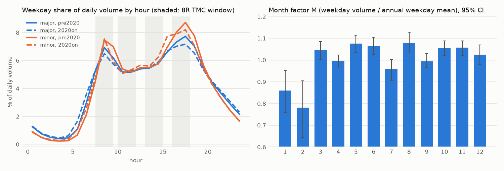

# Traffic volumes and AADT (CP5)

Exposure for the Phase 2 per-vehicle risk model. Every number here is regenerated by `python -m safepath volumes`.

## Sources

City of Toronto Open Data (CKAN API, packages found with `package_search` and an exact title match at run time). Licence: **Open Government Licence - Toronto**. Exact resources used (from `data/raw/volumes/manifest.json`):

| package | resource | resource id | MB | last modified |
|---|---|---|---:|---|
| `traffic-volumes-at-intersections-for-all-modes` | `tmc_summary_data.csv` | `b7ff9375-e215-408f-80a5-ec9e55246e19` | 7.5 | 2026-10-29 |
| `traffic-volumes-at-intersections-for-all-modes` | `tmc_raw_data_2010_2019.csv` | `96672ddd-387a-4686-bf2a-2e8d7e146a31` | 53.8 | 2026-10-29 |
| `traffic-volumes-at-intersections-for-all-modes` | `tmc_raw_data_2020_2029.csv` | `88ea1329-1da3-4992-bae6-a821d609d45d` | 88.6 | 2026-10-29 |
| `traffic-volumes-midblock-vehicle-speed-volume-and-classification-counts` | `svc_summary_data.csv` | `af1ccce4-d978-4a6d-9dc3-3fb33b1cc349` | 8.3 | 2026-10-29 |
| `traffic-volumes-midblock-vehicle-speed-volume-and-classification-counts` | `svc_raw_data_volume_2015_2019` | `3b7b04b1-9981-4a73-bb37-3f690a633b8b` | 82.3 | 2025-08-29 |
| `traffic-volumes-midblock-vehicle-speed-volume-and-classification-counts` | `svc_raw_data_volume_2020_2024` | `2aef8448-455c-4d61-8480-4fa38b5acf9a` | 2.5 | 2026-10-29 |
| `traffic-volumes-midblock-vehicle-speed-volume-and-classification-counts` | `svc_raw_data_speed_2020_2024` | `305156b5-6e7d-44ea-b4bd-5814dce0f128` | 350.1 | 2026-10-29 |
| `traffic-volumes-midblock-vehicle-speed-volume-and-classification-counts` | `svc_raw_data_speed_2025_2029` | `25a7459e-b3ac-46f1-9b76-393be209b02c` | 133.8 | 2026-10-29 |

- **TMC** (Turning Movement Counts): 30,961 counts at 6,402 locations, 1984-2026. Volume = motor vehicles entering the intersection, summed over approaches (cars + trucks + buses; checked equal to the sum of approach volumes). 902 mid-block TMCs (centreline type 1) are not used.
- **SVC** (Speed / Volume / Classification, pneumatic tubes): 43,896 studies after merging same-day duplicates, at 14,411 locations. The City's `avg_weekday_daily_vol` (both directions, whole days) is the daily estimate used; the 2015+ raw 15-minute files supply profiles and directions.

## TMC counted windows

Checked bin-by-bin against every count in the raw 2010-2029 files:

| code | windows | counts | years | raw-checked | % exact |
|---|---|---:|---|---:|---:|
| 8R | 07:30-09:30, 10:00-12:00, 13:00-15:00, 16:00-18:00 | 25,338 | 1984-2024 | 11,000 | 100.0 |
| 8S | 07:30-09:30, 10:00-11:00, 12:00-13:30, 14:15-15:45, 16:00-18:00 | 2,014 | 1985-2024 | 994 | 100.0 |
| 14 | 06:00-20:00 | 3,609 | 2023-2026 | 3,609 | 99.4 |

The few 14-hour counts with missing bins have their window volume scaled up by expected / present bins.

## AADT expansion

AADT = average daily two-way (SVC) or entering (TMC) motor-vehicle volume over a year. All factors come from the City's own SVC data:

- **R (window -> 24 h)**: from 20,347 complete count-days (every recorded direction has all 96 bins) in 5,896 SVC counts, 2015-2026. R = sum of daily volume / sum of volume inside the window, by era (2015-19 vs 2020+), road group (major = primary/secondary/trunk/motorway; minor = everything else; TMCs use the intersection's highest approach class) and day type.
- **D (day of week)** from 882 counts covering all 7 days: a day's volume relative to that count's Mon-Fri mean. **W** = mean of D over the week = **0.961** (average day / average weekday).
- **M (month)**: location fixed-effects regression `log v = a_location + b_month + c_year` on SVC weekday daily volumes (2010-2026, 2020-21 excluded, 3,283 locations counted in at least two months), normalised to a day-weighted annual mean of 1. CIs: 200 bootstrap resamples of locations.

TMC: `AADT = entering * R / D[dow] * W / M[month]`. SVC: `AADT = weekday daily * W / M[month]` (weekend-only studies are converted to a weekday equivalent with the mean Sat/Sun D).

### Window ratios R

| era | group | daytype | window | R | R_p10 | R_p90 | count_days | counts |
|---|---|---|---|---:|---:|---:|---:|---:|
| 2020on | major | weekday | 8R | 2.070 | 1.886 | 2.323 | 2,739 | 879 |
| 2020on | major | weekday | 8S | 2.027 | 1.834 | 2.314 | 2,739 | 879 |
| 2020on | major | weekday | 14 | 1.234 | 1.155 | 1.350 | 2,739 | 879 |
| 2020on | major | weekend | 8R | 2.285 | 2.024 | 2.680 | 321 | 161 |
| 2020on | major | weekend | 8S | 2.263 | 2.014 | 2.686 | 321 | 161 |
| 2020on | major | weekend | 14 | 1.361 | 1.228 | 1.582 | 321 | 161 |
| 2020on | minor | weekday | 8R | 1.928 | 1.685 | 2.151 | 11,429 | 3,896 |
| 2020on | minor | weekday | 8S | 1.861 | 1.598 | 2.092 | 11,429 | 3,896 |
| 2020on | minor | weekday | 14 | 1.176 | 1.088 | 1.255 | 11,429 | 3,896 |
| 2020on | minor | weekend | 8R | 2.232 | 1.882 | 2.608 | 544 | 295 |
| 2020on | minor | weekend | 8S | 2.208 | 1.854 | 2.540 | 544 | 295 |
| 2020on | minor | weekend | 14 | 1.332 | 1.159 | 1.492 | 544 | 295 |
| pre2020 | major | weekday | 8R | 2.008 | 1.856 | 2.175 | 3,089 | 775 |
| pre2020 | major | weekday | 8S | 1.969 | 1.812 | 2.137 | 3,089 | 775 |
| pre2020 | major | weekday | 14 | 1.212 | 1.150 | 1.293 | 3,089 | 775 |
| pre2020 | major | weekend | 8R | 2.173 | 1.976 | 2.529 | 921 | 451 |
| pre2020 | major | weekend | 8S | 2.145 | 1.950 | 2.523 | 921 | 451 |
| pre2020 | major | weekend | 14 | 1.311 | 1.216 | 1.503 | 921 | 451 |
| pre2020 | minor | weekday | 8R | 1.905 | 1.652 | 2.109 | 783 | 212 |
| pre2020 | minor | weekday | 8S | 1.860 | 1.618 | 2.069 | 783 | 212 |
| pre2020 | minor | weekday | 14 | 1.169 | 1.093 | 1.240 | 783 | 212 |
| pre2020 | minor | weekend | 8R | 2.011 | 1.855 | 2.141 | 150 | 65 |
| pre2020 | minor | weekend | 8S | 1.976 | 1.807 | 2.083 | 150 | 65 |
| pre2020 | minor | weekend | 14 | 1.229 | 1.159 | 1.289 | 150 | 65 |

### Day-of-week factors D

| day | D | D_sd | counts |
|---|---:|---:|---:|
| Mon | 0.956 | 0.071 | 882 |
| Tue | 0.994 | 0.036 | 882 |
| Wed | 1.004 | 0.042 | 882 |
| Thu | 1.017 | 0.048 | 882 |
| Fri | 1.029 | 0.068 | 882 |
| Sat | 0.922 | 0.160 | 882 |
| Sun | 0.803 | 0.166 | 882 |

### Month factors M

| month | M | SVC counts | M_lo | M_hi |
|---:|---:|---:|---:|---:|
| 1 | 0.860 | 181 | 0.758 | 0.951 |
| 2 | 0.781 | 193 | 0.643 | 0.905 |
| 3 | 1.044 | 771 | 1.002 | 1.085 |
| 4 | 0.995 | 1,676 | 0.968 | 1.024 |
| 5 | 1.075 | 1,050 | 1.034 | 1.114 |
| 6 | 1.064 | 1,142 | 1.025 | 1.105 |
| 7 | 0.958 | 277 | 0.904 | 1.003 |
| 8 | 1.078 | 325 | 1.032 | 1.127 |
| 9 | 0.994 | 1,085 | 0.964 | 1.029 |
| 10 | 1.054 | 1,168 | 1.022 | 1.088 |
| 11 | 1.057 | 864 | 1.021 | 1.088 |
| 12 | 1.024 | 448 | 0.980 | 1.069 |

### How good is the 24-hour expansion?

Ratios fitted on even-numbered SVC counts, applied to the simulated TMC windows of odd-numbered counts' weekdays, compared with their true 24-hour volume:

| window | test count-days | median abs % error | p90 abs % error | median % bias |
|---|---:|---:|---:|---:|
| 8R | 5,860 | 5.8 | 15.0 | 1.3 |
| 8S | 5,860 | 6.3 | 16.6 | 2.0 |
| 14 | 5,860 | 3.7 | 8.8 | 1.2 |

The window -> day step is accurate to a few percent. The month and day-of-week steps are not validated this way (no permanent counters in the City data) and are the larger uncertainty, along with count-to-count variation and staleness.

## Matching to the graph

- **TMC -> consolidated intersection** (within 40 m; among the 5 nearest, the one sharing the most street names): 29,789 of 30,059 intersection TMCs matched (99.1%) to 5,935 intersections. Match distance median 2.0 m, p95 9.5 m. 96.0% share at least two street names with the OSM intersection; 14 counts share none (unnamed OSM ramps). Unmatched counts are lanes, trails, and private roads with no drivable OSM intersection nearby (138 locations; nearest OSM intersection median 86 m).
- **SVC -> undirected segment** (within 40 m with the counted street's name, else the nearest within 15 m): 98.3% matched, 93.2% by name. Unmatched: laneways and park roads outside the drive graph.
- SVC studies not usable as segment AADT: 613 count one direction of a two-way street (raw files show a single direction); they are kept in the history but not used.

## Coverage

Crashes = TPS crashes assigned to intersections, 2016-2025.

| class combo | intersections | % counted | % counted 2015+ | crashes 2016-25 | % crashes at counted | % crashes at counted 2015+ |
|---|---:|---:|---:|---:|---:|---:|
| all | 22,435 | 26.5 | 21.1 | 528,547 | 78.3 | 72.7 |
| local x local | 11,209 | 11.6 | 7.3 | 57,133 | 23.6 | 17.3 |
| arterial x local | 3,649 | 61.9 | 50.8 | 171,711 | 80.9 | 72.1 |
| collector x local | 3,620 | 29.4 | 22.8 | 47,117 | 55.0 | 46.2 |
| arterial x arterial | 1,758 | 20.3 | 19.6 | 132,154 | 95.1 | 93.7 |
| arterial x collector | 732 | 88.3 | 82.7 | 91,719 | 95.0 | 92.1 |
| collector x collector | 570 | 34.9 | 30.2 | 14,266 | 87.2 | 71.7 |
| highway x highway | 569 | 0.4 | 0.0 | 1,339 | 0.0 | 0.0 |
| highway x arterial | 265 | 30.2 | 28.3 | 6,026 | 86.7 | 86.7 |
| highway x collector | 45 | 53.3 | 48.9 | 5,984 | 75.4 | 72.2 |
| highway x local | 18 | 44.4 | 44.4 | 1,098 | 61.4 | 61.4 |

Segments (undirected) with a usable SVC count:

| highway | segments | km | counted segments | % km counted |
|---|---:|---:|---:|---:|
| all | 41,070 | 6268.3 | 13,407 | 41.3 |
| residential | 23,711 | 3551.5 | 6,686 | 35.0 |
| secondary | 7,393 | 900.1 | 2,847 | 58.7 |
| tertiary | 5,831 | 792.9 | 2,597 | 60.9 |
| motorway | 442 | 328.2 | 44 | 11.5 |
| primary | 1,772 | 229.3 | 756 | 55.6 |
| motorway_link | 644 | 227.9 | 244 | 43.0 |
| unclassified | 833 | 201.2 | 181 | 33.1 |
| secondary_link | 222 | 15.1 | 30 | 27.9 |
| primary_link | 105 | 10.3 | 19 | 36.4 |
| busway | 20 | 6.0 | 0 | 0.0 |
| living_street | 45 | 3.8 | 1 | 2.0 |
| tertiary_link | 51 | 1.9 | 2 | 14.9 |

## Count recency

Most recent count year per counted unit. History is kept for every count (data/processed/tmc_aadt.parquet, svc_aadt.parquet).

| latest count year | intersections | segments |
|---|---:|---:|
| before 2000 | 125 | 205 |
| 2000-09 | 702 | 3,025 |
| 2010-14 | 378 | 4,654 |
| 2015-19 | 786 | 1,780 |
| 2020-21 | 416 | 938 |
| 2022-23 | 1,250 | 1,143 |
| 2024-26 | 2,278 | 1,662 |

7.0% of counted intersections have their most recent count in 2020-21, when volumes were depressed; `latest_noncovid_*` columns keep the latest count outside those years.

## AADT by class (most recent count)

Intersections, entering AADT:

| class combo | n | p10 | median | p90 | max |
|---|---:|---:|---:|---:|---:|
| arterial x arterial | 356 | 21,046 | 40,274 | 62,409 | 82,342 |
| highway x arterial | 80 | 22,370 | 39,191 | 64,737 | 113,004 |
| highway x local | 8 | 7,608 | 34,867 | 53,783 | 65,614 |
| arterial x collector | 646 | 15,698 | 27,377 | 43,858 | 78,604 |
| highway x collector | 24 | 15,330 | 25,595 | 64,347 | 76,488 |
| highway x highway | 2 | 13,703 | 25,285 | 36,866 | 39,762 |
| arterial x local | 2,260 | 12,616 | 22,841 | 37,961 | 70,839 |
| collector x collector | 199 | 4,418 | 11,486 | 21,235 | 37,087 |
| collector x local | 1,065 | 3,214 | 9,489 | 17,169 | 36,661 |
| local x local | 1,295 | 736 | 1,918 | 5,495 | 33,857 |

Segments, two-way AADT:

| highway | n | p10 | median | p90 | max |
|---|---:|---:|---:|---:|---:|
| motorway | 44 | 4,329 | 26,433 | 62,492 | 108,319 |
| primary | 756 | 9,998 | 16,635 | 31,590 | 62,790 |
| secondary | 2,847 | 7,586 | 14,995 | 27,468 | 68,922 |
| motorway_link | 244 | 1,614 | 7,461 | 18,020 | 65,055 |
| tertiary | 2,597 | 1,518 | 4,729 | 11,491 | 23,112 |
| tertiary_link | 2 | 1,704 | 4,723 | 7,742 | 8,497 |
| primary_link | 19 | 1,422 | 4,371 | 10,702 | 20,755 |
| secondary_link | 30 | 661 | 3,204 | 9,301 | 21,657 |
| unclassified | 181 | 765 | 2,486 | 8,005 | 55,336 |
| living_street | 1 | 1,068 | 1,068 | 1,068 | 1,068 |
| residential | 6,686 | 261 | 878 | 2,687 | 30,538 |

## Oddities

Highest entering AADT (most recent count):

| intersection | class combo | latest_year | latest_aadt | n_counts |
|---|---|---|---:|---:|
| Steeles Avenue East | highway x arterial | 2023 | 113,004 | 17 |
| Bayview Avenue / Sheppard Avenue East | arterial x arterial | 2024 | 82,342 | 27 |
| Keele Street / Steeles Avenue West | arterial x arterial | 2025 | 81,652 | 24 |
| Ellesmere Road / Warden Avenue | arterial x arterial | 2022 | 80,551 | 28 |
| Ellesmere Road / Kennedy Road | arterial x arterial | 2025 | 80,548 | 31 |
| Lake Shore Boulevard West / Windermere Avenue | arterial x collector | 2025 | 78,604 | 14 |
| Bayview Avenue / Steeles Avenue East | arterial x arterial | 2025 | 78,032 | 27 |
| Don Mills Road / York Mills Road | arterial x arterial | 2023 | 76,594 | 23 |
| Steeles Avenue East / Warden Avenue | arterial x arterial | 2023 | 76,514 | 24 |
| Kennedy Road / William Kitchen Road | highway x collector | 2018 | 76,488 | 13 |

- 5 counted local x local intersections exceed 20,000 entering AADT (OSM tags a busy road as residential, or the TMC sits at a consolidated cluster that OSM classes differently).
- 37 of 3,087 intersections counted at least twice since 2010 have counts more than 3x apart (construction detours, network changes, or a different count location under the same centreline id).
- 35 usable SVC studies on primary/secondary segments give AADT below 500 (likely a service road or a misplaced tube; left as is).
